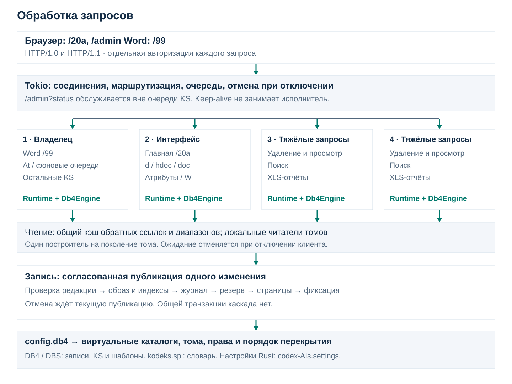

# codex-AIs

[Сокращения и термины: отчёты, ETW, KS/DB, Excel и другие обозначения](docs/GLOSSARY.md).

HTTP-сервер и интерпретатор KS для АИС «Судопроизводство» на платформе КОДЕКС. Написан на Rust. Читает существующие тома DB4/DBS, исполняет хранящиеся в них скрипты и отдаёт формы браузеру. Изменения документов записывает в штатный формат DB40.

Для работы нужен полный комплект данных суда: `config.db4`, подключённые тома, словарь и ресурсы. Базы, штатные KS, оригинальные EXE/DLL и шаблоны Office в репозиторий не входят. Отдельно выгружать KS для сборки не требуется.

Текущий выпуск — **0.31**. Ускорен отчёт «Итоги работы суда»: период 01.01–28.11.2026 рассчитан за 28,11 с против 110,57 с у kodweb, все 1880 ячеек совпали. Исправлено отображение процентов; подробная диагностика ошибок сохранена. [Профиль и сравнение](docs/COURT_TOTALS_0.31.md). Пул исполнителей остаётся классическим. `workers=auto` выделяет по одному тяжёлому исполнителю на доступное физическое ядро; Word, интерфейс и поиск сохраняют отдельные места. SMT/HT не удваивают тяжёлый пул, ручная настройка имеет приоритет. [Правило выбора и проверка шести одновременных отчётов](docs/AUTO_WORKERS_0.29.2.md). В `error.log` сохраняются исходный KS с отметкой места ошибки, стек вызовов, аргументы и переменные. Журналы хранятся в `Log-codex-AIS` внутри базы, ежедневные ZIP-архивы — в `OLD_Log`. [Формат журналов, ротация и границы проверки](docs/LOGGING_0.29.md). [Запуск и настройки сети](docs/BUILD_AND_RUN.md#сеть-и-порт). Лицензия **GPL-3.0-only**. Проект не связан с разработчиком КОДЕКС. Совместимость проверяется на одном контрольном комплекте. Другие выпуски АИС могут отличаться схемой томов и скриптами.

В **0.31** проверены сохранение, повторное открытие и обычная подпись Word при одновременном обмене, отчётах и удалениях. Дополнительных блокировок в двух проверенных распределениях пула не обнаружено. Добавлен тест резервов очереди Word и интерфейса. [Результаты](docs/WORD_MIXED_LOAD_0.31.md).

В **0.28.4** сохранён общий пул отчётов и удалений, как в 0.28.2. Эксперимент с отдельным резервом удалений не принят: он уменьшал их ожидание, но задерживал завершение нескольких отчётов. [Результаты эксперимента](docs/DELETION_QUEUE_0.28.3.md) · [Действующие правила очередей](docs/CONCURRENCY.md).

В **0.30** расширенные настройки разделены на группы. `/admin?status` показывает компактные цветовые индикаторы исполнителей KS/DB, ЦП и память процесса и системы без перезагрузки страницы. [Устройство и проверки](docs/ADMIN_MONITOR_0.30.md).

[Справка о нагрузке судей](docs/JUDGES_WORKLOAD_0.30.md) переведена в тяжёлую очередь: её расчёт больше не занимает исполнителя Word.

В 0.30 также подключён штатный раздел [«Средства проверки и конвертации»](docs/MAINTENANCE_0.30.md) — `/20a?mgmt`: проверки, исправления DB4 и ZIP-пакеты дела.

[Выдача и возврат из архива](docs/ARCHIVE_0.30.md) используют штатные формы и историю DB4. Карточка-заместитель RTF и результат сохранения сопоставлены с kodweb.

[Обмен между судами](docs/COURT_EXCHANGE_0.30.md) — `/20a?senddocs&`: штатные формы, настройки, SMTP/POP3, FTP и каталоги; пакеты `.7z` и `.pkg`. Работает ежедневное расписание отправки и приёма. Проверена совместимость с kodweb.

[Справочная система](docs/INFORMATION_SYSTEM_0.30.md) — `/20a?infSystem`: поиск заявлений и жалоб, карточка, история и сохраняемые настройки полей. Сохранены штатные формы kodweb.

[Печать наклеек](docs/STICKERS_0.30.md) — `/20a?sticker`: выбор дела, участников и бланка, наклейка и штрихкод в RTF. Для печати нужны доступные в базе бланки; контрольные файлы совпали с kodweb побайтно.

Исправлены запись кэша показателей главной страницы и чтение повторяющихся параметров `config.db4`, вызывавшие ошибки `persistent registry writes are not implemented` и `duplicate registry setting`. [Проверки исправлений](docs/SYSTEM_SETTINGS_0.27.md).

[Сравнение 3, 4, 5 и 7 тяжёлых исполнителей](docs/WORKER_SCALING_0.28.3.md) на машине с 6 ядрами / 12 логическими процессорами: четыре сократили очередь удалений с 50–53 до 32–35 секунд, пять быстрее завершали тяжёлый пакет, семь заметно увеличивали задержки страниц и поиска. Это исторический замер со смешанной нагрузкой и прежним правилом `auto`; подбор в 0.29.2 описан выше.

Для проверки на других устройствах добавлен [переносимый нагрузочный тест](docs/PORTABLE_BENCHMARK.md): Python без сторонних библиотек, автоматическое сравнение профилей, отчёт HTML/CSV/JSON. В 0.28.4 число исполнителей интерфейса настраивается отдельно внутри общего пула. По умолчанию остаётся один, владелец Word и очередь поиска сохраняются.

В **0.28** добавлено [восстановление нескольких файлов `.kod` с предварительным списком конфликтов](docs/KOD_RESTORE_0.28.md). В области P → «Закачать .kod» появилась ссылка на пакетное восстановление. Сначала выбираются файлы и том, затем подтверждаются нужные объекты и замены.

В предварительном списке также проверяются связи: есть ли объект в базе или среди файлов, выбран ли он для восстановления. Кнопка «Добавить связанные файлы» отмечает недостающие зависимости из пакета; исходные номера и ссылки сохраняются.

Если в пакете несколько файлов одного объекта, можно сравнить их атрибуты и выбрать нужный вариант. Совпадения по номеру и имени показываются до записи; редакция связанного объекта выбирается вручную.

При замене доступно сравнение с существующей записью выбранного тома. Форма показывает прежние номера, которые исчезнут, и ссылки на них из выбранных файлов. Эти ссылки не переназначаются.

В списке выбора [основания документа](docs/BASIS_PICKER_0.28.md) теперь видны тип, дата регистрации и идентификатор или входящий номер. В карточку возвращаются прежние ссылки, без добавления этих пояснений в атрибуты.

В **0.27** общие настройки системы сохраняются штатными кнопками `/20a?adminsettings`, включая «Все режимы», следующий номер дела и следующий входящий номер. Изменения одной формы записываются совместно в `config.db4`. [Устройство, сравнение с kodweb и границы проверки](docs/SYSTEM_SETTINGS_0.27.md).

Также исправлены [открытие новых документов через `d/hdoc`, вкладки и страницы списка](docs/DOCUMENT_OPEN_0.27.md). Штатная форма [«Фильтр/Сортировка» и переходы между документами](docs/CASE_LIST_0.27.md) сохраняют условия и позицию в списке; проверены 302 варианта сортировки. Улучшены [выгрузка RTF с таблицами и рисунками](docs/RTF_EXPORT_0.27.md) и [импорт рисунков при обычном подписании из Word](docs/RTF_IMPORT_0.27.md).

В **0.26** почтовый отчёт `/20a?reportForPostServices` передаёт таблицу по мере расчёта строк. Повторные SQL-запросы используют общий кэш строковых атрибутов: на контрольном периоде 01.01–24.11.2026 время сократилось с 862 до 31,4 с. Все 103 строки и 506 ячеек совпали с kodweb. Запрос выполняется в тяжёлой группе KS/DB. [Устройство, условия измерения и проверки](docs/POSTAL_REPORT_0.26.md).

Включены подготовленные ранее исправления **0.25.3**: исправлен запуск с недоступным файловым хранилищем и добавлено чтение порта из `config.db4`. [Причина ошибки и сравнение с kodweb](docs/STARTUP_0.25.3.md).

В **0.25.2** исправлено распознавание пути `Log` при распределении на Unix. Повторно проверены регистрация с вложениями, открытие после перезапуска и чтение записей обоими серверами. [Регистрация и ручной ввод](docs/REGISTRATION_0.21.md#проверка-регистрации-и-вложений-в-0252), [путь журнала распределения](docs/DISTRIBUTION_0.21.md#журнал-распределения-на-unix--0252).

В **0.25.1** исправлено открытие зарегистрированного дела и заявления при отсутствии месячной настройки файлового хранилища. Если отдельный путь не задан, используется обычное хранилище без попытки записать пустую ветку в `config.db4`. [Причина и проверка](docs/REGISTRATION_0.21.md#открытие-зарегистрированного-дела-в-0251).

В **0.25.1** убрана дополнительная форма «Изменения не сохранены» при редактировании атрибутов. Сохранение и очистка РР М используют штатную форму, как в kodweb; проверка версии открытой вкладки больше не применяется. [Поведение и проверка](docs/P_AREA_0.22.md#сохранение-атрибутов-с-0251).

В 0.24 исправлены [открытие атрибутов во всех проверенных областях P](docs/P_ATTRIBUTES_0.24.md), [блокировка статкарт и проверка доступа](docs/STATCARD_P_0.24.md), [обычное подписание, открытие и разблокирование документов из Word](docs/WORD_STATCARD_0.24.md). Добавлена [выгрузка обычных аншлагов в Word](docs/NOTICES_WORD_0.24.md).

В версии **0.25** исправлены дополнительные ошибки подписания шаблонов Word: разбор таблиц RTF и чтение бинарных полей через `/99`. Проверены 80 шаблонов; 46 прошли полный цикл сохранения, открытия и подписания. [Результаты и ограничения](docs/WORD_TEMPLATES_0.25.md).

В этой же версии исправлена кнопка Word «Доступ» и добавлена работа штатного раздела регистрации диапазонов почтовых штрихкодов. [Что проверено](docs/WORD_ACCESS_POSTAL_0.25.md).

В 0.23: [общая очередь тяжёлых запросов, режим `workers=auto` при запуске и проверка размеров пула](docs/SCHEDULING_0.23.md). Ручное число исполнителей в существующих настройках сохраняет приоритет.

[Интерфейс и маршрутизация отчётов в 0.23](docs/INTERFACE_0.23.md): все отчёты и справки раздела «Формирование судебной статистики» контрольного комплекта — 31 пункт — выполняются в тяжёлой группе; меню остаётся у интерфейса, две редактируемые статистические карточки — у владельца. Свободные тяжёлые исполнители помогают занятому интерфейсу. Добавлен общий кэш готовых CSS, JavaScript и изображений с проверкой доступа и обновлением при изменении источника.

[Оба варианта аншлагов в 0.23](docs/NOTICES_0.23.md): расчёт настраиваемого аншлага `/80/` и отдельной формы 16 из `/81/` перенесён в тяжёлую группу. Остальные 22 стандартные формы уже используют тяжёлый маршрут `convertToExcel`. Настройки и XML-выгрузка сохраняют последовательное исполнение. Исправлено чтение форматированных заголовков обычных форм 6 и 8.

[Сравнение кэша 8, 32 и 64 страницы](docs/SCALAR_CACHE_0.23.md): выбрано 64 × 64 КиБ. В проверке трёх одновременных удалений медиана снизилась с 20,77 до 16,30 с, логический объём чтения — с 30,18 до 15,51 ГиБ. Само увеличение страничного кэша не дало подтверждённого ускорения отчётов; расход памяти при их расчёте вырос. Исправлен также отказ доступа при обновлении резервного файла, который в Windows ещё открыт в контексте чтения прежней версии.

[Ускорение расчёта судебных отчётов в 0.23](docs/REPORT_PERFORMANCE_0.23.md): после оптимизации списков и чтения записей дополнительно ускорены точное преобразование денежных полей и проверка размера файлов, изменено вытеснение записей из кэша. Годовой 1АС за 2025 год занял 215 с вместо 281 с, четыре месячных одновременно — 55 с вместо 72 с. Пик частной памяти годового расчёта снизился с 714 до 658 МиБ. XLS совпали побайтно; в разборе приведены профиль, другие формы отчётов и условия измерения.

## Зачем нужен проект

codex-AIs сохраняет существующие данные и формы АИС, позволяя развивать сервер независимо от старого Windows/Office-окружения. В текущей реализации сеть, интерфейс и тяжёлые задачи разделены; исполнители используют общий кэш обратных ссылок и отбора, XLS формируется без серверных Excel/MSXML, запись DB4 имеет журнал восстановления.

Ускорение зависит от сценария. Его дают алгоритмы, меньшее число повторных обращений и разделение работы. KS выполняется синхронно в отдельных потоках, а изменение DB4 по-прежнему согласуется последовательно. При двух удалениях kodweb потоки конкурируют за общий буфер тома размером 4 КиБ и повторно читают перекрывающиеся участки. [Полная трасса и контроль с одним CPU](docs/READ_AMPLIFICATION_0.18.md) установили причину основного прироста чтений. На простом удалении малого рабочего тома kodweb в проверенной серии быстрее.

[Архитектура, алгоритмы и разбор измерений](docs/ARCHITECTURE_AND_PERFORMANCE.md) · [презентация PDF](docs/presentations/codex-AIs-architecture-0.18.pdf) · [PowerPoint](docs/presentations/codex-AIs-architecture-0.18.pptx).

[Профили удаления и формирования отчёта 1АС: kodweb и Rust, отдельный опыт с пересчётом Excel](docs/PROFILING_0.18.md). Презентации обновлены 19 ноября 2026 года: 25 слайдов с результатами профилирования, опытом с пересчётом Excel и пояснением разницы между временем выполнения и процессорным временем. Подробные данные и ограничения приведены в разборе.

## Быстрый запуск на Windows

Готовая сборка для **Windows x64**: [скачать codex-AIs.exe версии 0.30](https://github.com/Hannabiann/codex-AIs/releases/download/v0.30/codex-AIs.exe). Также доступны [ZIP-архив](https://github.com/Hannabiann/codex-AIs/releases/download/v0.30/codex-AIs-0.30-windows-x86_64.zip) и [страница Releases](https://github.com/Hannabiann/codex-AIs/releases). Rust и средства сборки для запуска не нужны.

1. Сделайте независимую копию полного комплекта КОДЕКС, например `C:\kodeks-test`. Скопируйте `codex-AIs.exe` в её корень, рядом с `config.db4` и оригинальными EXE.
2. Остановите другой сервер, работающий с этим комплектом, дождитесь завершения процесса и освобождения порта 8070. Откройте PowerShell и выполните команды ниже, заменив путь к копии на свой.

```powershell
Set-Location C:\kodeks-test
.\codex-AIs.exe
```

С 0.29 журналы создаются в `Log-codex-AIS` внутри базы: для `C:\kodeks-test` это `C:\kodeks-test\Log-codex-AIS`. Ошибки записываются в `error.log`, завершённые запросы — в `access.log`. ZIP-архивы за прошлые дни находятся в `OLD_Log`; по умолчанию хранятся 7 дней. Срок меняется в `/admin?advanced` и применяется после перезапуска. [Формат и проверки](docs/LOGGING_0.29.md). Явный `KODEKS_LOG_DIR` переопределяет каталог.

EXE можно также запустить двойным щелчком: база определяется по `config.db4` рядом с программой.

3. Оставьте окно сервера открытым и перейдите на [главную страницу](http://localhost:8070/20a/). Администрирование: [localhost:8070/admin/](http://localhost:8070/admin/). По умолчанию сервер слушает все IPv4-интерфейсы; с другого компьютера используйте IP-адрес или имя сервера. Выбор «Только localhost» и смена порта доступны в `/admin?advanced`; изменения применяются после перезапуска. Если в `config.db4` задан другой порт, используйте его вместо 8070.

[Что проверять в первую очередь](docs/TESTING.md). [Подробный запуск и восстановление перед переключением на kodweb](#запуск).

## Реализованные разделы

| Раздел | Что работает на контрольном комплекте |
|---|---|
| `/20a/`, `d`, `hdoc`, `doc` | Главная, карточки дел и документов, вкладки, текст и вложения. В 0.27 исправлено открытие документов со ссылкой на отсутствующую форму и убрана лишняя пустая вкладка «Отправка». [Проверки](docs/DOCUMENT_OPEN_0.27.md) |
| Поиск | Быстрый и связанный, классификаторы «…», фразы, CONTAINS, FREETEXT; отдельного ограничения 10 000 результатов нет |
| Реестры | Проверен каталог из 210 пунктов на небольших интервалах; результаты и исключения перечислены в документации |
| Статистика | Отчёт 1АС о работе суда и нерегламентная статистика Z22.1, в том числе годовые за 2025 год; формирование XLS без серверных Excel и MSXML |
| Аншлаги и графики | `/80/`: настраиваемый аншлаг, порядок и состав колонок, шрифт, печать и XML-выгрузка. `/81/`: каталог обычных форм, включая группировку по судьям и датам. `/77/`: график рассмотрения банкротных дел. Настройки сохраняются в штатных томах. [Настраиваемый вариант и графики](docs/SCHEDULES_0.22.md), [проверка обоих аншлагов](docs/NOTICES_0.23.md) |
| Атрибуты | Создание и сохранение через `ispravlenieForm` |
| Область P | Штатные списки областей и объектов, фильтр, страницы, создание и изменение, календарь и классификаторы, удаление, импорт `.kod` в выбранный том. [Проверки и ограничения 0.22](docs/P_AREA_0.22.md) |
| Регистрация | Первичная регистрация `/30` и входящие документы к делу `/32`: штатные формы, участники, создание дела и документов, счётчики в `config.db4`, загрузка и скачивание вложений. [Проверенные сценарии и ограничения 0.21](docs/REGISTRATION_0.21.md) |
| Удаление | `DeleteObject`: обход ссылок, предварительный список, отметка удаления, множественный выбор, экспорт `.kod` |
| W | Скачивание сохранённого в томе RTF |
| Выгрузка внутреннего текста | RTF из атрибутов области P: вложенные таблицы, изображения внутри абзацев, GIF и символы рамок. [Проверки 0.27](docs/RTF_EXPORT_0.27.md) |
| Импорт текста Word | При обычном подписании WMF и резервные рисунки Word сохраняются во внутреннем тексте DB4. Исправлена совместимость таблиц с отрицательным отступом. [Проверки и ограничения 0.27](docs/RTF_IMPORT_0.27.md) |
| Пользователи | `/99?createnewuser&`: регистрация и карточка сотрудника; `/users?users`: группы, приостановка входа и срок действия. Доступ 21 группы к десяти разделам совпал с kodweb. [Инструкция](docs/USERS_0.21.md), [одновременная регистрация и исправления 0.21.1](docs/USERS_CONCURRENCY_0.21.1.md) |
| `/99` | Word 2024 со штатной надстройкой `spdas.dotm` получает бланк, создаёт документ в выбранном деле, находит акт по идентификатору, открывает выбранную редакцию и сохраняет правки неподписанного акта в DB4. Штатный kodweb прочитал сохранённый из Word RTF побайтно. Отдельно проверены создание и чтение двух редакций через HTTP. В 0.24 проверены обычное подписание без ЭЦП, открытие из списка неподписанных и запросы на разблокирование |
| Общие настройки системы | Открытие и сохранение 42 разделов штатными формами, включая «Все режимы», регистрационные номера, реквизиты суда и месячные пути хранилища. Запись в `config.db4`, проверка прав и конфликта изменений. [Проверки 0.27](docs/SYSTEM_SETTINGS_0.27.md) |
| Распределение | Штатные настройки, категории, сложность и блокировки. Автоматический выбор судей и запись назначений через `/20a?Raspred_Del_Auto`; массовое восстановление КП через `/20a?restorekp`. В 0.30 — [перераспределение без IE](docs/REDISTRIBUTION_0.30.md). [Настройки и категории](docs/DISTRIBUTION_0.20.md), [сравнение распределения и КП с kodweb](docs/DISTRIBUTION_0.21.md) |
| Рабочий график суда | `/97`: штатный календарь, рабочие и выходные дни, отпуска сотрудников, графики арбитражных заседателей и создание календаря нового года. Настройки доступа к форме отпусков сохраняются в config.db4. [Сценарии и проверка 0.21](docs/COURT_CALENDAR_0.21.md) |
| `/admin/` | Основные страницы, сведения об ОС, настройки Rust, очередь и состояние исполнителей |
| Конкурентная работа | При `auto` тяжёлых исполнителей столько же, сколько доступных физических ядер; Word, интерфейс и поиск добавляются отдельно. Общий предел — 32, ручная настройка имеет приоритет. Общие кэши, отдельная очередь тяжёлых запросов; отмена при отключении клиента |

Формулы в XLS сохраняются для пересчёта клиентским Excel или LibreOffice. Проверка совпадения отчётов сравнивает константы и семантику формул, а не их кэшированные результаты.

## Ограничения

Сверено с кодом 0.29.2. Для форка используйте [актуальную карту модулей и оставшихся задач](docs/DEVELOPMENT.md), для поиска материалов — [указатель документации](docs/README.md).

- Язык KS и хостовые API реализованы частично. Для некоторых форм требуется неподдержанная функция. Есть частичное исполнение байткода распределения; произвольный KS без исходного текста не поддерживается автоматически.
- В локальной 0.30 проверены [формирование XML БРАС, XSD и сохранение GZIP](docs/BRAS_EXCHANGE_0.30.md). Доставка в БРАС/КАД и импорт входящих XML БРАС требуют отдельной проверки. SMTP/POP3, FTP и файловый обмен между судами описаны [отдельно](docs/COURT_EXCHANGE_0.30.md). Сохранение настроек сервиса само по себе не подтверждает обмен. Параметры, которые штатные KS читают только при запуске, требуют перезапуска; новый порт применяется при запуске слушателя.
- Импорт обычных объектов из `.kod` реализован. Импорт исполняемых KS-форм и скриптов требует генерации совместимого байткода и пока не поддерживается. Не все команды панели P и старых `spdas.dot`/`spdas.dotm` проверены. Экспериментальный Word-клиент в эту публикацию не включён.
- Перезапись непустых CTF-индексов и произвольных полнотекстовых индексов документов не поддерживается. Импорт RTF и сохранение самого внутреннего текста CTF реализованы; это разные операции. Отдельно реализован словарный индекс логинов в пользовательских томах DB40 6.12. Сохранение RTF само по себе не обновляет индексируемый текст.
- Нет общей транзакции каскада удаления и единого снимка всей базы на время отчёта. Уже выполненная часть каскада не откатывается при отмене.
- Большой предварительный список через общие реестры может строиться долго. Полное завершение одного такого случая не подтверждено; главная при его выполнении продолжает обслуживаться.
- Неизвестные KS, Word и фоновые задания At остаются у одного владельца. Долгое At может задержать Word.
- Запись ограничена образом тома до 256 МиБ и миллионом записей при подготовке. Эти ограничения не относятся к чтению больших архивов и числу результатов поиска. NTLM не реализован.
- Серверное сохранение и чтение электронной подписи RTF, PDF и его подписи проверены с тестовым RSA-сертификатом. Полный повтор через кнопки Word после исправления PDF, ГОСТ, аппаратный токен и доверенная цепочка не проверены. [Границы проверки ЭП](docs/WORD_SIGNATURE_0.25.md).

Новые операции записи проверены на Windows x64. Полный цикл этого выпуска на Linux и FreeBSD ещё не проверен.

## Устройство

<picture>
  <source media="(prefers-color-scheme: dark)" srcset="docs/images/architecture-dark.svg">
  <source media="(prefers-color-scheme: light)" srcset="docs/images/architecture.svg">
  
</picture>

Схема выше относится к 0.18 и иллюстрирует конфигурацию с четырьмя исполнителями. В 0.29.2 `workers=auto` выделяет тяжёлых по доступным физическим ядрам и добавляет владельца, интерфейс и поиск. Общая тяжёлая очередь и помощь интерфейсу сохранены. [Текущая схема и модули](docs/DEVELOPMENT.md#путь-запроса).

Подключения, схемы и порядок томов читаются из `config.db4`; фиксированного списка файлов `old` или `work` нет. Каждый исполнитель имеет свой Runtime и Db4Engine. При четырёх исполнителях один обслуживает Word/At и состояние каталогов, второй — известные формы интерфейса, третий — поиск, четвёртый — удаления и отчёты XLS. Число исполнителей меняется в `/admin?advanced`. Результаты диапазонов, обратные ссылки и строковые колонки общие: один исполнитель строит недостающий индекс, остальные ожидают и используют готовый результат. KS-состояние, права и контексты чтения томов остаются локальными.

Публикации DB4 согласуются последовательно. Перед записью проверяется ожидаемая редакция. Небольшое изменение записывается страницами с журналом восстановления; предыдущая версия остаётся в резервном DB4. При большом объёме изменений используется замена полного файла. Отключение клиента отменяет вычисления; начатая публикация завершается целиком. [Пул, отмена и keep-alive](docs/CONCURRENCY.md).

<picture>
  <source media="(prefers-color-scheme: dark)" srcset="docs/images/writer-dark.svg">
  <source media="(prefers-color-scheme: light)" srcset="docs/images/writer.svg">
  
</picture>

В 0.17 простое удаление тоже изменяет отдельные узлы B-деревьев. Для числовых полей с идентификаторами вроде `номер/год` удаляется точный ключ с сохранением штатного порядка. Свободные блоки ищутся непосредственно в карте тома. Резерв сравнивается порциями по 64 КиБ; записываются изменённые страницы. Для страничной записи сохраняются прежние и новые данные изменяемых страниц. Открытые контексты чтения получают прежний образ в памяти и продолжают чтение без смешивания версий. Это требует дополнительной памяти на время таких чтений. [Протокол записи и восстановления](docs/DB40_WRITES.md).

## Измерения

[Смешанная нагрузка 30 сеансов](docs/MIXED_LOAD_0.28.2.md): браузер, протокол Word, два отчёта 1АС и два удаления. Codex-AIs обработал 5 081 запрос без ошибок; p95 поиска — 8,47 с, у kodweb — 33,12 с. В отчёте приведены условия опыта, проверка совпадения данных, расход памяти и профиль повторных чтений MainKey.

Историческая серия профилирования Rust 0.18, 19 ноября 2026 года. Это не повторный замер 0.28.2. Время контрольных запусков без ETW:

| Сценарий | kodweb.exe, с | Rust 0.18, с |
|---|---:|---:|
| Два архивных документа, удалить по очереди | 342,420 | 28,503 |
| Те же документы, удалить одновременно | 763,146 | 17,003 |
| Два отчёта 1АС за январь 2025, по очереди | 1474,237 | 87,773 |

Одновременное формирование двух отчётов 1АС в Rust заняло 61,175 с. У kodweb в обеих парных попытках HTTP-клиент получил только один целый XLS, поэтому успешное время пары не указано. Отдельный опыт с одинаковыми XML и шаблоном: ручной режим Excel при заполнении и один полный пересчёт сократили конвертацию с 189,212 до 121,889 с; результат совпал.

По одному запуску на конфигурацию, полная восстановленная копия, кэш ОС не очищался. Rust сохраняет формулы для клиентского пересчёта; одна готовая книга дополнительно пересчитана в Excel и совпала с оригиналом по значениям и формулам. [Методика, CPU/I/O, стеки ожиданий и проверка 14 XLS](docs/PROFILING_0.18.md), [агрегаты JSON](docs/profiling-0.18.json).

### Общий кэш: сравнение 0.17.1 и 0.18

Два одновременных удаления реальных документов из архивных томов, 18 ноября 2026 года. Удаляются связанные объекты, создаются отметки и KOD. Указано время до завершения обоих запросов.

| Документы | Rust 0.17.1, с | Rust 0.18, с | kodweb.exe, с | Ускорение Rust |
|---|---:|---:|---:|---:|
| 2026 | 26,739 | 17,319 | 737,179 | 1.54× |
| 2020 | 28,219 | 18,089 | 1163,657 | 1.56× |

Rust — медианы трёх запусков каждой версии; kodweb — один запуск каждой пары. Перед каждым запуском восстановлен одинаковый снимок, процесс новый, предпросмотра удаления нет. Кэш ОС не очищался. У Rust четыре исполнителя, два для тяжёлых запросов. [Все повторения, прогрев одного исполнителя и проверка результатов](docs/SHARED_CACHE_0.18.md), [машинные данные](docs/shared-cache-0.18.json).

<picture>
  <source media="(prefers-color-scheme: dark)" srcset="docs/images/shared-cache-dark.svg">
  <source media="(prefers-color-scheme: light)" srcset="docs/images/shared-cache.svg">
  
</picture>

[Прежняя таблица одиночных, последовательных и одновременных удалений, включая kodweb64](docs/REAL_DELETION_0.17.1.md) сохранена отдельно: это другая серия измерений.

Следующий график относится к отдельному тесту **новых искусственных дел с одним заголовком** в маленьком рабочем томе и к прежнему замеру отчётов. Его время удаления нельзя переносить на реальные архивные документы.

<picture>
  <source media="(prefers-color-scheme: dark)" srcset="docs/images/benchmarks-dark.svg">
  <source media="(prefers-color-scheme: light)" srcset="docs/images/benchmarks.svg">
  
</picture>

Результаты относятся к одной Windows-машине и полной копии одного комплекта. Серверы запускались последовательно, файловый кэш ОС не очищался. [Все времена, параметры и методика](docs/BENCHMARKS.md). Исторические замеры годовых отчётов приведены отдельно от новых измерений удаления.

## Сборка

Нужны Rust/Cargo и системный компоновщик. Для Windows — MSVC C++ Build Tools с Windows SDK; для Debian/Ubuntu — `build-essential` и `pkg-config`. Установка Rust: [rust-lang.org](https://rust-lang.org/tools/install/), [требования Windows MSVC](https://rust-lang.github.io/rustup/installation/windows-msvc.html).

```sh
cargo build --release --locked
```

Бинарник: `target/release/codex-AIs.exe` на Windows, `target/release/codex-AIs` на Unix. Для сборки копируйте весь репозиторий: кроме `src` и файлов Cargo нужны `build.rs` и `assets` с иконкой. `Cargo.lock` включён для повторяемой сборки. MSXML, Office, оригинальный EXE и отдельные `.ks` для компиляции не нужны. [Полные инструкции, включая FreeBSD](docs/BUILD_AND_RUN.md).

## Запуск

Первые проверки выполняйте на независимой копии полного комплекта. Скопируйте бинарник рядом с `config.db4` и запускайте из этого каталога. Сначала остановите другой сервер и убедитесь, что процесс завершился и порт свободен. Одновременный запуск нескольких серверов на одних томах не поддерживается. После аварийной остановки Rust перед запуском kodweb выполните `codex-AIs recover <каталог данных>`: оригинал не читает журнал восстановления Rust.

Windows PowerShell:

```powershell
Set-Location C:\kodeks
$env:KODEKS_DATA_DIR = (Get-Location).Path
.\codex-AIs.exe
```

Linux / FreeBSD:

```sh
cd /srv/kodeks
env KODEKS_DATA_DIR="$PWD" \
    ./codex-AIs
```

Главная: `http://<адрес-сервера>:<порт>/20a/`, администрация: `/admin/`. С 0.25.3 порт читается из `config.db4` (`SOFTWARE\Kodeks\Web`, `Port`); если параметра нет — 8070. Явный `KODEKS_PORT` имеет приоритет. С 0.28.1 адрес по умолчанию — `0.0.0.0` (все IPv4-интерфейсы); в более ранних версиях — `127.0.0.1`. В 0.28.1 выбор localhost и изменение порта доступны в `/admin?advanced`. Явный `KODEKS_HOST` имеет приоритет над выбором в форме. Фактический адрес печатается при запуске и показан в `/admin?status`.

С 0.28.1 при запуске сервера без `KODEKS_DATA_DIR` используется каталог EXE, если рядом есть `config.db4`; иначе — рабочий каталог. В 0.28 используется рабочий каталог. Команда `serve` означает запуск HTTP-сервера; её можно не писать. Другие команды, например `recover`, остаются явными. В 0.29 каталог журналов по умолчанию — `Log-codex-AIS` внутри базы; при отсутствии прав запуск завершается с понятной ошибкой. Параметры Rust сохраняются в `codex-AIs.settings` рядом с бинарником. В 0.28.1 отдельная кнопка сохраняет общий с kodweb порт в `config.db4`. Сетевые настройки применяются после перезапуска.

## Тестирование и разработка

- [Очередность проверок для тестировщика](docs/TESTING.md).
- [Руководство для форка: модули, реализованное и оставшиеся задачи](docs/DEVELOPMENT.md).
- [Указатель актуальных руководств и исторических проверок](docs/README.md).
- [Правила изменений и PR](CONTRIBUTING.md).
- [История версий](CHANGELOG.md), [проверка 0.18](docs/VALIDATION_0.18.md), [проверка 0.17](docs/VALIDATION_0.17.md), [проверка 0.16](docs/VALIDATION_0.16.md), [проверка 0.15](docs/VALIDATION_0.15.md), [проверка 0.14.1](docs/VALIDATION_0.14.1.md).

Исследовательские тесты, данные дел и диагностические выгрузки исключены из публикации. `cargo test` этой копии не воспроизводит проверки полного комплекта. Новые синтетические тесты можно добавлять в форке.

## Лицензия

[GNU GPL v3](LICENSE), SPDX `GPL-3.0-only`. [Лицензии зависимостей](THIRD_PARTY_LICENSES.md) и [NOTICE](NOTICE) приложены. Лицензия проекта не распространяется на комплект КОДЕКС, судебные данные и штатные шаблоны.

Название объединяет созвучие с «КОДЕКС», сокращение АИС и указание на использование ИИ при разработке.
