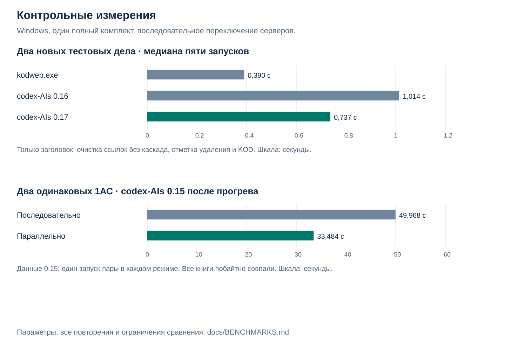

# codex-AIs

HTTP-сервер и интерпретатор KS для АИС «Судопроизводство» на платформе КОДЕКС. Написан на Rust. Читает существующие тома DB4/DBS, исполняет хранящиеся в них скрипты и отдаёт формы браузеру. Изменения документов записывает в штатный формат DB40.

Для работы нужен полный комплект данных суда: `config.db4`, подключённые тома, словарь и ресурсы. Базы, штатные KS, оригинальные EXE/DLL и шаблоны Office в репозиторий не входят. Отдельно выгружать KS для сборки не требуется.

Версия **0.16**, лицензия **GPL-3.0-only**. Проект не связан с разработчиком КОДЕКС. Совместимость проверяется на одном контрольном комплекте; другие выпуски АИС могут отличаться схемой и скриптами.

## Реализованные разделы

| Раздел | Что работает на контрольном комплекте |
|---|---|
| `/20a/`, `d`, `hdoc`, `doc` | Главная, карточки дел и документов, вкладки, текст и вложения |
| Поиск | Быстрый и связанный, классификаторы «…», фразы, CONTAINS, FREETEXT; отдельного ограничения 10 000 результатов нет |
| Реестры | Проверен каталог из 210 пунктов на небольших интервалах; результаты и исключения перечислены в документации |
| Статистика | 1АС и Z22.1, в том числе годовые за 2025 год; формирование XLS без серверных Excel и MSXML |
| Атрибуты | Создание и сохранение через `ispravlenieForm` |
| Удаление | `DeleteObject`: обход ссылок, предварительный список, отметка удаления, множественный выбор, экспорт `.kod` |
| W | Скачивание сохранённого в томе RTF |
| `/99` | Основные операции открытия, сохранения RTF и редакций Word в DB4; HTTP keep-alive |
| `/admin/` | Основные страницы, сведения об ОС, настройки Rust, очередь и состояние исполнителей |
| Конкурентная работа | По умолчанию четыре исполнителя KS/DB; отмена запроса при отключении клиента |

Формулы в XLS сохраняются для пересчёта клиентским Excel или LibreOffice. Проверка совпадения отчётов сравнивает константы и семантику формул, а не их кэшированные результаты.

## Ограничения

- Язык KS и хостовые API реализованы частично. Для некоторых форм требуется неподдержанная функция или байткод без исходного текста.
- Импорт для восстановления `.kod`, все команды панели P и весь протокол старых `spdas.dot`/`spdas.dotm` не реализованы. Экспериментальный Word-клиент в эту публикацию не включён.
- Перезапись непустых CTF и глобальных полнотекстовых индексов не поддерживается. Сохранение RTF само по себе не обновляет индексируемый текст.
- Нет общей транзакции каскада удаления и единого снимка всей базы на время отчёта. Уже выполненная часть каскада не откатывается при отмене.
- Большой предварительный список через общие реестры может строиться долго. Полное завершение одного такого случая не подтверждено; главная при его выполнении продолжает обслуживаться.
- Неизвестные KS, Word и фоновые задания At остаются у одного владельца. Долгое At может задержать Word.
- Запись ограничена образом тома до 256 МиБ и миллионом записей. Большие архивные тома читаются индексно. NTLM и полный цикл электронной подписи не реализованы.

Новые операции записи проверены на Windows x64. Полный цикл этого выпуска на Linux и FreeBSD ещё не проверен.

## Устройство


Подключения, схемы и порядок томов читаются из `config.db4`; фиксированного списка файлов `old` или `work` нет. Каждый исполнитель имеет свой Runtime и Db4Engine. При четырёх исполнителях один обслуживает Word/At и состояние каталогов, второй — известные формы интерфейса, ещё два — поиск, удаление и XLS. Число исполнителей меняется в `/admin?advanced`.

Публикации DB4 согласуются последовательно. Перед записью проверяется ожидаемая редакция. Небольшое изменение записывается страницами с журналом восстановления; предыдущая версия остаётся в резервном DB4. При большом объёме изменений используется замена полного файла. Отключение клиента отменяет вычисления; начатая публикация завершается целиком. [Пул, отмена и keep-alive](docs/CONCURRENCY.md).


В 0.16 добавление записи и индексных значений обновляет отдельные ветви B-деревьев. Остальные изменения используют существующие индексы вместо разбора всех документов тома. Для страничной записи сохраняются прежние и новые данные изменяемых страниц. Открытые читатели получают прежний образ в памяти и продолжают чтение без смешивания версий. Это требует дополнительной памяти на время таких чтений. [Протокол записи и восстановления](docs/DB40_WRITES.md).

## Измерения



Результаты относятся к одной Windows-машине и полной копии одного комплекта. Серверы запускались последовательно, файловый кэш ОС не очищался. [Все времена, параметры и методика](docs/BENCHMARKS.md). Исторические замеры годовых отчётов приведены отдельно от новых измерений удаления.

## Сборка

Нужны Rust/Cargo и системный компоновщик. Для Windows — MSVC C++ Build Tools с Windows SDK; для Debian/Ubuntu — `build-essential` и `pkg-config`. Установка Rust: [rust-lang.org](https://rust-lang.org/tools/install/), [требования Windows MSVC](https://rust-lang.github.io/rustup/installation/windows-msvc.html).

```sh
cargo build --release --locked
```

Бинарник: `target/release/codex-AIs.exe` на Windows, `target/release/codex-AIs` на Unix. `Cargo.lock` включён для повторяемой сборки. MSXML, Office, оригинальный EXE и отдельные `.ks` для компиляции не нужны. [Полные инструкции, включая FreeBSD](docs/BUILD_AND_RUN.md).

## Запуск

Первые проверки выполняйте на независимой копии полного комплекта. Скопируйте бинарник рядом с `config.db4` и запускайте из этого каталога. Сначала остановите другой сервер и убедитесь, что процесс завершился и порт свободен. Одновременный запуск нескольких серверов на одних томах не поддерживается. После аварийной остановки Rust перед запуском kodweb выполните `codex-AIs recover <каталог данных>`: оригинал не читает журнал восстановления Rust.

Windows PowerShell:

```powershell
Set-Location C:\kodeks
New-Item -ItemType Directory -Path C:\codex-AIs-logs -Force | Out-Null
$env:KODEKS_DATA_DIR = (Get-Location).Path
$env:KODEKS_LOG_DIR = 'C:\codex-AIs-logs'
$env:KODEKS_HOST = '0.0.0.0'
$env:KODEKS_PORT = '8070'
.\codex-AIs.exe serve
```

Linux / FreeBSD:

```sh
cd /srv/kodeks
mkdir -p /srv/codex-AIs-logs
env KODEKS_DATA_DIR="$PWD" KODEKS_LOG_DIR=/srv/codex-AIs-logs \
    KODEKS_HOST=0.0.0.0 KODEKS_PORT=8070 ./codex-AIs serve
```

Главная: `http://<адрес-сервера>:8070/20a/`, администрация: `/admin/`. По умолчанию сервер слушает `127.0.0.1:8070`; `0.0.0.0` включает все IPv4-интерфейсы.

Без `KODEKS_DATA_DIR` корнем данных считается текущий рабочий каталог. Папка журналов должна находиться вне дерева данных. Параметры Rust сохраняются в `codex-AIs.settings` рядом с бинарником; настройки не записываются в `config.db4`.

## Тестирование и разработка

- [Очередность проверок для тестировщика](docs/TESTING.md).
- [Карта модулей и задачи для разработчика](docs/DEVELOPMENT.md).
- [Правила изменений и PR](CONTRIBUTING.md).
- [История версий](CHANGELOG.md), [проверка 0.16](docs/VALIDATION_0.16.md), [проверка 0.15](docs/VALIDATION_0.15.md), [проверка 0.14.1](docs/VALIDATION_0.14.1.md).

Исследовательские тесты, данные дел и диагностические выгрузки исключены из публикации. `cargo test` этой копии не воспроизводит проверки полного комплекта. Новые синтетические тесты можно добавлять в форке.

## Лицензия

[GNU GPL v3](LICENSE), SPDX `GPL-3.0-only`. [Лицензии зависимостей](THIRD_PARTY_LICENSES.md) и [NOTICE](NOTICE) приложены. Лицензия проекта не распространяется на комплект КОДЕКС, судебные данные и штатные шаблоны.

Название объединяет созвучие с «КОДЕКС», сокращение АИС и указание на использование ИИ при разработке.
