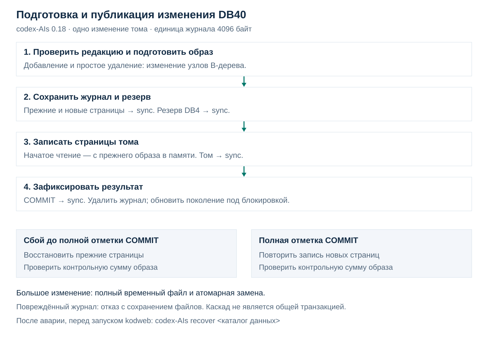
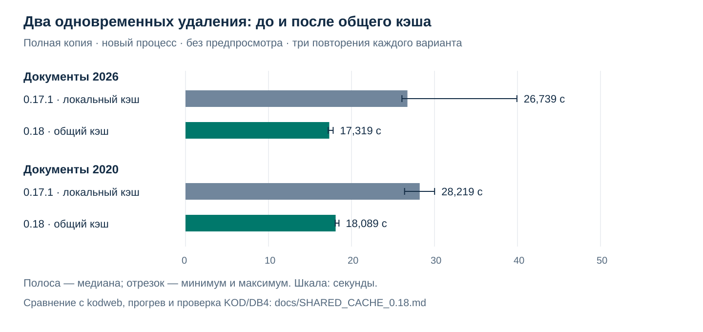

# codex-AIs

[Сокращения и термины: отчёты, ETW, KS/DB, Excel и другие обозначения](docs/GLOSSARY.md).

HTTP-сервер и интерпретатор KS для АИС «Судопроизводство» на платформе КОДЕКС. Написан на Rust. Читает существующие тома DB4/DBS, исполняет хранящиеся в них скрипты и отдаёт формы браузеру. Изменения документов записывает в штатный формат DB40.

Для работы нужен полный комплект данных суда: `config.db4`, подключённые тома, словарь и ресурсы. Базы, штатные KS, оригинальные EXE/DLL и шаблоны Office в репозиторий не входят. Отдельно выгружать KS для сборки не требуется.

Текущий выпуск **0.24**, лицензия **GPL-3.0-only**. Проект не связан с разработчиком КОДЕКС. Совместимость проверяется на одном контрольном комплекте. Другие выпуски АИС могут отличаться схемой томов и скриптами.

В 0.24 исправлены [открытие атрибутов во всех проверенных областях P](docs/P_ATTRIBUTES_0.24.md), [блокировка статкарт и проверка доступа](docs/STATCARD_P_0.24.md), [обычное подписание, открытие и разблокирование документов из Word](docs/WORD_STATCARD_0.24.md). Добавлена [выгрузка обычных аншлагов в Word](docs/NOTICES_WORD_0.24.md).

В 0.23: [общая очередь тяжёлых запросов, режим `workers=auto` при запуске и проверка размеров пула](docs/SCHEDULING_0.23.md). Ручное число исполнителей в существующих настройках сохраняет приоритет.

[Интерфейс и маршрутизация отчётов в 0.23](docs/INTERFACE_0.23.md): все отчёты и справки раздела «Формирование судебной статистики» контрольного комплекта — 31 пункт — выполняются в тяжёлой группе; меню остаётся у интерфейса, две редактируемые статистические карточки — у владельца. Свободные тяжёлые исполнители помогают занятому интерфейсу. Добавлен общий кэш готовых CSS, JavaScript и изображений с проверкой доступа и обновлением при изменении источника.

[Оба варианта аншлагов в 0.23](docs/NOTICES_0.23.md): расчёт настраиваемого аншлага `/80/` и отдельной формы 16 из `/81/` перенесён в тяжёлую группу. Остальные 22 стандартные формы уже используют тяжёлый маршрут `convertToExcel`. Настройки и XML-выгрузка сохраняют последовательное исполнение. Исправлено чтение форматированных заголовков обычных форм 6 и 8.

[Сравнение кэша 8, 32 и 64 страницы](docs/SCALAR_CACHE_0.23.md): выбрано 64 × 64 КиБ. В проверке трёх одновременных удалений медиана снизилась с 20,77 до 16,30 с, логический объём чтения — с 30,18 до 15,51 ГиБ. Само увеличение страничного кэша не дало подтверждённого ускорения отчётов; расход памяти при их расчёте вырос. Исправлен также отказ доступа при обновлении резервного файла, который ещё держит старый читатель Windows.

[Ускорение расчёта судебных отчётов в 0.23](docs/REPORT_PERFORMANCE_0.23.md): после оптимизации списков и чтения записей дополнительно ускорены точное преобразование денежных полей и проверка размера файлов, изменено вытеснение записей из кэша. Годовой 1АС за 2025 год занял 215 с вместо 281 с, четыре месячных одновременно — 55 с вместо 72 с. Пик частной памяти годового расчёта снизился с 714 до 658 МиБ. XLS совпали побайтно; в разборе приведены профиль, другие формы отчётов и условия измерения.

## Зачем нужен проект

codex-AIs сохраняет существующие данные и формы АИС, позволяя развивать сервер независимо от старого Windows/Office-окружения. В текущей реализации сеть, интерфейс и тяжёлые задачи разделены; исполнители используют общий кэш обратных ссылок и отбора, XLS формируется без серверных Excel/MSXML, запись DB4 имеет журнал восстановления.

Ускорение зависит от сценария. Его дают алгоритмы, меньшее число повторных обращений и разделение работы. KS выполняется синхронно в отдельных потоках, а изменение DB4 по-прежнему согласуется последовательно. При двух удалениях kodweb потоки конкурируют за общий буфер тома размером 4 КиБ и повторно читают перекрывающиеся участки. [Полная трасса и контроль с одним CPU](docs/READ_AMPLIFICATION_0.18.md) установили причину основного прироста чтений. На простом удалении малого рабочего тома kodweb в проверенной серии быстрее.

[Архитектура, алгоритмы и разбор измерений](docs/ARCHITECTURE_AND_PERFORMANCE.md) · [презентация PDF](docs/presentations/codex-AIs-architecture-0.18.pdf) · [PowerPoint](docs/presentations/codex-AIs-architecture-0.18.pptx).

[Профили удаления и формирования отчёта 1АС: kodweb и Rust, отдельный опыт с пересчётом Excel](docs/PROFILING_0.18.md). Презентации обновлены 19 ноября 2026 года: 25 слайдов с результатами профилирования, опытом с пересчётом Excel и пояснением разницы между временем выполнения и процессорным временем. Подробные данные и ограничения приведены в разборе.

## Быстрый запуск на Windows

Готовая сборка для **Windows x64**: [скачать codex-AIs.exe версии 0.24](https://github.com/Hannabiann/codex-AIs/releases/download/v0.24/codex-AIs.exe). Также доступны [ZIP-архив](https://github.com/Hannabiann/codex-AIs/releases/download/v0.24/codex-AIs-0.24-windows-x86_64.zip) и [страница Releases](https://github.com/Hannabiann/codex-AIs/releases). Rust и средства сборки для запуска не нужны.

1. Сделайте независимую копию полного комплекта КОДЕКС, например `C:\kodeks-test`. Скопируйте `codex-AIs.exe` в её корень, рядом с `config.db4` и оригинальными EXE.
2. Остановите другой сервер, работающий с этим комплектом, дождитесь завершения процесса и освобождения порта 8070. Откройте PowerShell и выполните команды ниже, заменив путь к копии на свой.

```powershell
Set-Location C:\kodeks-test
.\codex-AIs.exe serve
```

Начиная с 0.17 папка журналов создаётся автоматически рядом с каталогом данных: для `C:\kodeks-test` это `C:\kodeks-test.codex-AIs-logs`. Путь выводится в консоль. Для другого места задайте `$env:KODEKS_LOG_DIR = 'D:\codex-AIs-logs'`; каталог будет создан и проверен до запуска обработчиков. В старом релизе 0.16 эту переменную и существующую папку нужно задавать вручную.

3. Оставьте окно сервера открытым и перейдите на [главную страницу](http://localhost:8070/20a/). Администрирование: [localhost:8070/admin/](http://localhost:8070/admin/). Для доступа с других компьютеров перед запуском задайте `$env:KODEKS_HOST = '0.0.0.0'` и используйте IP-адрес сервера.

[Что проверять в первую очередь](docs/TESTING.md). [Подробный запуск и восстановление перед переключением на kodweb](#запуск).

## Реализованные разделы

| Раздел | Что работает на контрольном комплекте |
|---|---|
| `/20a/`, `d`, `hdoc`, `doc` | Главная, карточки дел и документов, вкладки, текст и вложения |
| Поиск | Быстрый и связанный, классификаторы «…», фразы, CONTAINS, FREETEXT; отдельного ограничения 10 000 результатов нет |
| Реестры | Проверен каталог из 210 пунктов на небольших интервалах; результаты и исключения перечислены в документации |
| Статистика | Отчёт 1АС о работе суда и нерегламентная статистика Z22.1, в том числе годовые за 2025 год; формирование XLS без серверных Excel и MSXML |
| Аншлаги и графики | `/80/`: настраиваемый аншлаг, порядок и состав колонок, шрифт, печать и XML-выгрузка. `/81/`: каталог обычных форм, включая группировку по судьям и датам. `/77/`: график рассмотрения банкротных дел. Настройки сохраняются в штатных томах. [Настраиваемый вариант и графики](docs/SCHEDULES_0.22.md), [проверка обоих аншлагов](docs/NOTICES_0.23.md) |
| Атрибуты | Создание и сохранение через `ispravlenieForm` |
| Область P | Штатные списки областей и объектов, фильтр, страницы, создание и изменение, календарь и классификаторы, удаление, импорт `.kod` в выбранный том. [Проверки и ограничения 0.22](docs/P_AREA_0.22.md) |
| Регистрация | Первичная регистрация `/30` и входящие документы к делу `/32`: штатные формы, участники, создание дела и документов, счётчики в `config.db4`, загрузка и скачивание вложений. [Проверенные сценарии и ограничения 0.21](docs/REGISTRATION_0.21.md) |
| Удаление | `DeleteObject`: обход ссылок, предварительный список, отметка удаления, множественный выбор, экспорт `.kod` |
| W | Скачивание сохранённого в томе RTF |
| Пользователи | `/99?createnewuser&`: регистрация и карточка сотрудника; `/users?users`: группы, приостановка входа и срок действия. Доступ 21 группы к десяти разделам совпал с kodweb. [Инструкция](docs/USERS_0.21.md), [одновременная регистрация и исправления 0.21.1](docs/USERS_CONCURRENCY_0.21.1.md) |
| `/99` | Word 2024 со штатной надстройкой `spdas.dotm` получает бланк, создаёт документ в выбранном деле, находит акт по идентификатору, открывает выбранную редакцию и сохраняет правки неподписанного акта в DB4. Штатный kodweb прочитал сохранённый из Word RTF побайтно. Отдельно проверены создание и чтение двух редакций через HTTP. В 0.24 проверены обычное подписание без ЭЦП, открытие из списка неподписанных и запросы на разблокирование |
| Общие настройки системы | На контрольном комплекте открываются 42 раздела, включая «Все режимы». В «Первичной регистрации» и «Всех режимах» кнопка «Сохранить только номера» записывает следующий номер дела и следующий входящий номер в `config.db4` |
| Распределение | Штатные настройки, категории, сложность и блокировки. Автоматический выбор судей и запись назначений через `/20a?Raspred_Del_Auto`; массовое восстановление КП через `/20a?restorekp`. [Настройки и категории](docs/DISTRIBUTION_0.20.md), [сравнение распределения и КП с kodweb](docs/DISTRIBUTION_0.21.md) |
| Рабочий график суда | `/97`: штатный календарь, рабочие и выходные дни, отпуска сотрудников, графики арбитражных заседателей и создание календаря нового года. Настройки доступа к форме отпусков сохраняются в config.db4. [Сценарии и проверка 0.21](docs/COURT_CALENDAR_0.21.md) |
| `/admin/` | Основные страницы, сведения об ОС, настройки Rust, очередь и состояние исполнителей |
| Конкурентная работа | При запуске автоматически выбираются 3–6 исполнителей KS/DB; ручная настройка имеет приоритет. Общие кэши, отдельная очередь тяжёлых запросов; отмена при отключении клиента |

Формулы в XLS сохраняются для пересчёта клиентским Excel или LibreOffice. Проверка совпадения отчётов сравнивает константы и семантику формул, а не их кэшированные результаты.

## Ограничения

- Язык KS и хостовые API реализованы частично. Для некоторых форм требуется неподдержанная функция или байткод без исходного текста.
- Сохранение остальных общих настроек штатной кнопкой формы реализовано частично. Для двух регистрационных номеров используйте отдельную кнопку рядом с полями. Если значения уже изменились, сервер предложит открыть форму заново.
- Импорт для восстановления `.kod`, все команды панели P и весь протокол старых `spdas.dot`/`spdas.dotm` не реализованы. Экспериментальный Word-клиент в эту публикацию не включён.
- Перезапись непустых CTF и полнотекстовых индексов документов не поддерживается. Отдельно реализован словарный индекс логинов в пользовательских томах DB40 6.12. Сохранение RTF само по себе не обновляет индексируемый текст.
- Нет общей транзакции каскада удаления и единого снимка всей базы на время отчёта. Уже выполненная часть каскада не откатывается при отмене.
- Большой предварительный список через общие реестры может строиться долго. Полное завершение одного такого случая не подтверждено; главная при его выполнении продолжает обслуживаться.
- Неизвестные KS, Word и фоновые задания At остаются у одного владельца. Долгое At может задержать Word.
- Запись ограничена образом тома до 256 МиБ и миллионом записей. Большие архивные тома читаются индексно. NTLM и полный цикл электронной подписи не реализованы.

Новые операции записи проверены на Windows x64. Полный цикл этого выпуска на Linux и FreeBSD ещё не проверен.

## Устройство

<picture>
  <source media="(prefers-color-scheme: dark)" srcset="docs/images/architecture-dark.svg">
  <source media="(prefers-color-scheme: light)" srcset="docs/images/architecture.svg">
  
</picture>

Подключения, схемы и порядок томов читаются из `config.db4`; фиксированного списка файлов `old` или `work` нет. Каждый исполнитель имеет свой Runtime и Db4Engine. При четырёх исполнителях один обслуживает Word/At и состояние каталогов, второй — известные формы интерфейса, ещё два — поиск, удаление и XLS. Число исполнителей меняется в `/admin?advanced`. С 0.18 результаты диапазонов и обратные ссылки общие: один исполнитель строит недостающий индекс, остальные ожидают и используют готовый результат. KS-состояние, права и читатели томов остаются локальными.

Публикации DB4 согласуются последовательно. Перед записью проверяется ожидаемая редакция. Небольшое изменение записывается страницами с журналом восстановления; предыдущая версия остаётся в резервном DB4. При большом объёме изменений используется замена полного файла. Отключение клиента отменяет вычисления; начатая публикация завершается целиком. [Пул, отмена и keep-alive](docs/CONCURRENCY.md).

<picture>
  <source media="(prefers-color-scheme: dark)" srcset="docs/images/writer-dark.svg">
  <source media="(prefers-color-scheme: light)" srcset="docs/images/writer.svg">
  
</picture>

В 0.17 простое удаление тоже изменяет отдельные узлы B-деревьев. Для числовых полей с идентификаторами вроде `номер/год` удаляется точный ключ с сохранением штатного порядка. Свободные блоки ищутся непосредственно в карте тома. Резерв сравнивается порциями по 64 КиБ; записываются изменённые страницы. Для страничной записи сохраняются прежние и новые данные изменяемых страниц. Открытые читатели получают прежний образ в памяти и продолжают чтение без смешивания версий. Это требует дополнительной памяти на время таких чтений. [Протокол записи и восстановления](docs/DB40_WRITES.md).

## Измерения

Новая серия профилирования, 19 ноября 2026 года. Время контрольных запусков без ETW:

| Сценарий | kodweb.exe, с | Rust 0.18, с |
|---|---:|---:|
| Два архивных документа, удалить по очереди | 342,420 | 28,503 |
| Те же документы, удалить одновременно | 763,146 | 17,003 |
| Два отчёта 1АС за январь 2025, по очереди | 1474,237 | 87,773 |

Одновременное формирование двух отчётов 1АС в Rust заняло 61,175 с. У kodweb в обеих парных попытках HTTP-клиент получил только один целый XLS, поэтому успешное время пары не указано. Отдельный опыт с одинаковыми XML и шаблоном: ручной режим Excel при заполнении и один полный пересчёт сократили конвертацию с 189,212 до 121,889 с; результат совпал.

По одному запуску на конфигурацию, полная восстановленная копия, кэш ОС не очищался. Rust сохраняет формулы для клиентского пересчёта; одна готовая книга дополнительно пересчитана в Excel и совпала с оригиналом по значениям и формулам. [Методика, CPU/I/O, стеки ожиданий и проверка 14 XLS](docs/PROFILING_0.18.md), [агрегаты JSON](docs/profiling-0.18.json).

### Общий кэш: сравнение 0.17.1 и 0.18

Два одновременных удаления реальных документов из архивных томов, 18 ноября 2026 года. Удаляются связанные объекты, создаются отметки и KOD. Указано время до завершения обоих запросов.

| Документы | Rust 0.17.1, с | Rust 0.18, с | kodweb.exe, с | Ускорение Rust |
|---|---:|---:|---:|---:|
| 2026 | 26,739 | 17,319 | 737,179 | 1.54× |
| 2020 | 28,219 | 18,089 | 1163,657 | 1.56× |

Rust — медианы трёх запусков каждой версии; kodweb — один запуск каждой пары. Перед каждым запуском восстановлен одинаковый снимок, процесс новый, предпросмотра удаления нет. Кэш ОС не очищался. У Rust четыре исполнителя, два для тяжёлых запросов. [Все повторения, прогрев одного исполнителя и проверка результатов](docs/SHARED_CACHE_0.18.md), [машинные данные](docs/shared-cache-0.18.json).

<picture>
  <source media="(prefers-color-scheme: dark)" srcset="docs/images/shared-cache-dark.svg">
  <source media="(prefers-color-scheme: light)" srcset="docs/images/shared-cache.svg">
  
</picture>

[Прежняя таблица одиночных, последовательных и одновременных удалений, включая kodweb64](docs/REAL_DELETION_0.17.1.md) сохранена отдельно: это другая серия измерений.

Следующий график относится к отдельному тесту **новых искусственных дел с одним заголовком** в маленьком рабочем томе и к прежнему замеру отчётов. Его время удаления нельзя переносить на реальные архивные документы.

<picture>
  <source media="(prefers-color-scheme: dark)" srcset="docs/images/benchmarks-dark.svg">
  <source media="(prefers-color-scheme: light)" srcset="docs/images/benchmarks.svg">
  
</picture>

Результаты относятся к одной Windows-машине и полной копии одного комплекта. Серверы запускались последовательно, файловый кэш ОС не очищался. [Все времена, параметры и методика](docs/BENCHMARKS.md). Исторические замеры годовых отчётов приведены отдельно от новых измерений удаления.

## Сборка

Нужны Rust/Cargo и системный компоновщик. Для Windows — MSVC C++ Build Tools с Windows SDK; для Debian/Ubuntu — `build-essential` и `pkg-config`. Установка Rust: [rust-lang.org](https://rust-lang.org/tools/install/), [требования Windows MSVC](https://rust-lang.github.io/rustup/installation/windows-msvc.html).

```sh
cargo build --release --locked
```

Бинарник: `target/release/codex-AIs.exe` на Windows, `target/release/codex-AIs` на Unix. Для сборки копируйте весь репозиторий: кроме `src` и файлов Cargo нужны `build.rs` и `assets` с иконкой. `Cargo.lock` включён для повторяемой сборки. MSXML, Office, оригинальный EXE и отдельные `.ks` для компиляции не нужны. [Полные инструкции, включая FreeBSD](docs/BUILD_AND_RUN.md).

## Запуск

Первые проверки выполняйте на независимой копии полного комплекта. Скопируйте бинарник рядом с `config.db4` и запускайте из этого каталога. Сначала остановите другой сервер и убедитесь, что процесс завершился и порт свободен. Одновременный запуск нескольких серверов на одних томах не поддерживается. После аварийной остановки Rust перед запуском kodweb выполните `codex-AIs recover <каталог данных>`: оригинал не читает журнал восстановления Rust.

Windows PowerShell:

```powershell
Set-Location C:\kodeks
New-Item -ItemType Directory -Path C:\codex-AIs-logs -Force | Out-Null
$env:KODEKS_DATA_DIR = (Get-Location).Path
$env:KODEKS_LOG_DIR = 'C:\codex-AIs-logs'
$env:KODEKS_HOST = '0.0.0.0'
$env:KODEKS_PORT = '8070'
.\codex-AIs.exe serve
```

Linux / FreeBSD:

```sh
cd /srv/kodeks
mkdir -p /srv/codex-AIs-logs
env KODEKS_DATA_DIR="$PWD" KODEKS_LOG_DIR=/srv/codex-AIs-logs \
    KODEKS_HOST=0.0.0.0 KODEKS_PORT=8070 ./codex-AIs serve
```

Главная: `http://<адрес-сервера>:8070/20a/`, администрация: `/admin/`. По умолчанию сервер слушает `127.0.0.1:8070`; `0.0.0.0` включает все IPv4-интерфейсы.

Без `KODEKS_DATA_DIR` корнем данных считается текущий рабочий каталог. Папка журналов должна находиться вне дерева данных. Без `KODEKS_LOG_DIR` сервер создаёт соседний каталог `<имя каталога данных>.codex-AIs-logs`; при отсутствии прав запуск завершается с понятной ошибкой. Параметры Rust сохраняются в `codex-AIs.settings` рядом с бинарником; настройки не записываются в `config.db4`.

## Тестирование и разработка

- [Очередность проверок для тестировщика](docs/TESTING.md).
- [Карта модулей и задачи для разработчика](docs/DEVELOPMENT.md).
- [Правила изменений и PR](CONTRIBUTING.md).
- [История версий](CHANGELOG.md), [проверка 0.18](docs/VALIDATION_0.18.md), [проверка 0.17](docs/VALIDATION_0.17.md), [проверка 0.16](docs/VALIDATION_0.16.md), [проверка 0.15](docs/VALIDATION_0.15.md), [проверка 0.14.1](docs/VALIDATION_0.14.1.md).

Исследовательские тесты, данные дел и диагностические выгрузки исключены из публикации. `cargo test` этой копии не воспроизводит проверки полного комплекта. Новые синтетические тесты можно добавлять в форке.

## Лицензия

[GNU GPL v3](LICENSE), SPDX `GPL-3.0-only`. [Лицензии зависимостей](THIRD_PARTY_LICENSES.md) и [NOTICE](NOTICE) приложены. Лицензия проекта не распространяется на комплект КОДЕКС, судебные данные и штатные шаблоны.

Название объединяет созвучие с «КОДЕКС», сокращение АИС и указание на использование ИИ при разработке.
