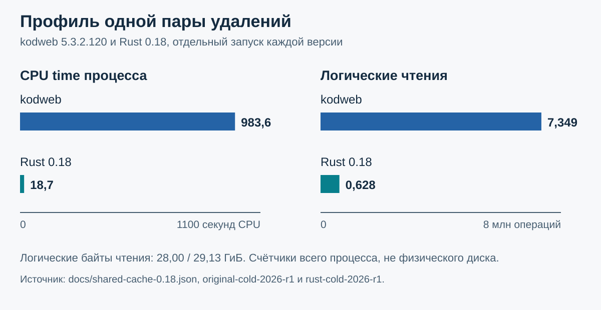
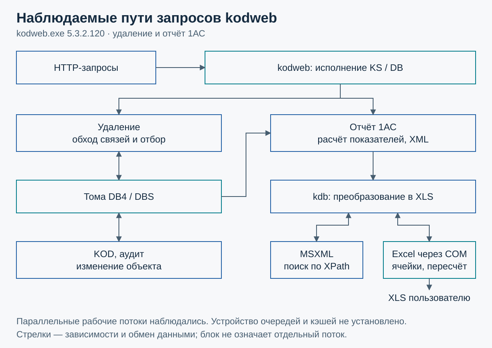
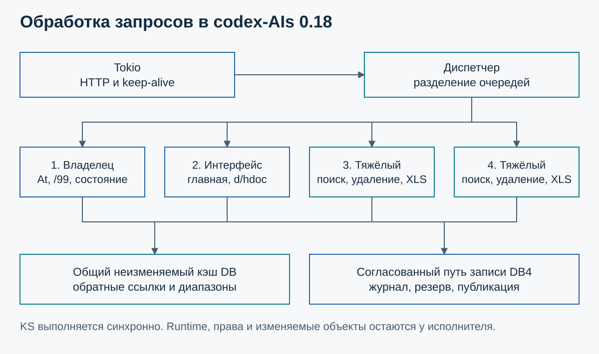
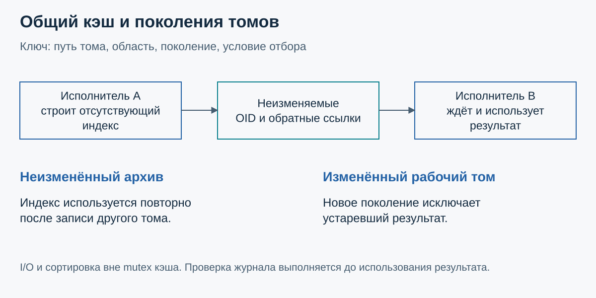

# Архитектура и производительность codex-AIs

[Сокращения и термины: отчёты, ETW, KS/DB, Excel и другие обозначения](GLOSSARY.md).

Описание текущей архитектуры сверено с **0.28.1** 26 ноября 2026 года. Числа, трассы и сравнительные графики этой статьи относятся к историческим сериям **0.17–0.18**; повторных измерений 0.28.1 здесь нет. Данные серии 19 ноября 2026 года: [профили удаления и формирования отчёта 1АС, опыт с пересчётом Excel](PROFILING_0.18.md). [Презентация PDF](presentations/codex-AIs-architecture-0.18.pdf) и [PowerPoint](presentations/codex-AIs-architecture-0.18.pptx) обновлены 19 ноября 2026 года: 25 слайдов, результаты профилирования, понятные названия отчётов и объяснение времени выполнения и процессорного времени.

codex-AIs исполняет существующие формы и KS АИС «Судопроизводство», читает штатные тома и записывает изменения в DB40. Цель проекта — сделать этот стек переносимым, доступным для проверки и доработки: сохранить данные и рабочие сценарии, отделить обслуживание пользователей от тяжёлых вычислений, сократить повторную работу, убрать серверную зависимость отчётов от Office. Совместимость ещё неполная. Перечень реализованного и ограничений находится в [README](../README.md).

## Почему нельзя объяснить всё пулом потоков

Синхронный обработчик может эффективно работать в пуле системных потоков. Асинхронная сеть помогает обслуживать ожидающие соединения, но сама по себе не сокращает обход связей, расчёт отчёта или запись индексов.

В codex-AIs сеть обслуживает Tokio, а KS/DB работают **синхронно в отдельных системных потоках**. Поэтому утверждение «kodweb синхронный, Rust асинхронный, отсюда всё ускорение» неверно описывает даже Rust-часть. Здесь важны разделение задач, алгоритмы и повторное использование данных. Общее правило о CPU-нагрузке и блокирующем коде описано в [документации используемого Tokio 1.43](https://docs.rs/tokio/1.43.0/tokio/index.html#cpu-bound-tasks-and-blocking-code).

В проверенном `kodweb.exe` 5.3.2.120 записаны ETW-профили CPU, переключений потоков и I/O. При двух удалениях видны два работающих потока и частые короткие ожидания в `RtlEnterCriticalSection`. В контрольном запуске без профилировщика одновременно растут процессорное время и число логических чтений. Это свидетельствует и о конкуренции за критические секции, и о дополнительной работе. В последующем опыте установлен общий буфер тома размером 4 КиБ: чередующиеся обходы вытесняют его содержимое и перечитывают перекрывающиеся участки. Привязка kodweb к одному логическому CPU вернула число чтений пары почти к последовательному уровню. [Механизм и причинный контроль](READ_AMPLIFICATION_0.18.md). [Трассы в числах и границы выводов](PROFILING_0.18.md).

| Наблюдение | Что из него следует | Чего оно не доказывает |
|---|---|---|
| Два удаления в kodweb занимают дольше, чем два по очереди в проверенной серии | Данная нагрузка плохо масштабируется | Что весь сервер однопоточный |
| В парных удалениях отношение суммарного процессорного времени к времени выполнения равно 1,33–1,39 | Процесс в среднем использовал больше одного ядра, но далеко не весь доступный CPU | Точное число рабочих потоков или место общей блокировки |
| Много логических чтений при большом процессорном времени | Стоимость обработки и обращений к данным существенна | Что все прочитанные байты пришли с физического диска |
| 64-битный kodweb не стал быстрее в этой серии | Смена разрядности не устраняет все затраты | Что x64 медленнее вообще: сравнивались разные версии EXE |

В одном окне профиля все чтения архивного тома выполнялись по 4 КиБ; часть смещений встретилась дважды. Профиль не разделяет все причины повторов: устройство кэшей, вытеснение и повторный отбор требуют дополнительных опытов. Разбор машинного кода помогает объяснить горячие циклы, но сам по себе не измеряет их стоимость.

## Что показывают счётчики процесса

Один запуск пары реальных документов 2026 года из серии 0.18. В обоих случаях удаление завершилось, состав каскадов и содержимое KOD проверены. Это отдельные строки `original-cold-2026-r1` и `rust-cold-2026-r1`, **не медианы**.

| Метрика | kodweb 5.3.2.120 | codex-AIs 0.18 |
|---|---:|---:|
| Время двух ответов, с | 737,179 | 17,319 |
| Суммарное процессорное время, с | 983,641 | 18,672 |
| Логические операции чтения процесса | 7 348 781 | 627 805 |
| Прочитано логически, ГиБ | 28,00 | 29,13 |

Rust в этой паре прочитал немного больше логических байтов, но сделал значительно меньше обращений и потратил меньше CPU. Поэтому объяснение только скоростью HDD/NVMe не соответствует этим счётчикам. Они включают I/O всего процесса за интервал, а не только DB4; это не трасса физического диска и не распределение времени по функциям. Источник: [все исходные числа 0.18](shared-cache-0.18.json).

<picture>
  <source media="(prefers-color-scheme: dark)" srcset="images/process-cost-dark.svg">
  
</picture>

## Как проходит запрос в kodweb

Схема отражает наблюдаемые пути в `kodweb.exe` 5.3.2.120: удаление и формирование отчёта 1АС. Это не полная реконструкция сервера. Сопоставление TCP-соединений, Thread ID и процессорного времени подтвердило: в проверенных маршрутах один обработчик обслуживает HTTP, выполняет KS/DB и остаётся занятым при ожидании конвертера. Внутренний алгоритм очередей и устройство кэшей не восстановлены. [Проверка по Thread ID](KODWEB_THREADS_0.18.md).

<picture>
  <source media="(prefers-color-scheme: dark)" srcset="images/kodweb-request-path-dark.svg">
  
</picture>

Стрелки показывают зависимости и обмен данными. Блоки внутри kodweb не означают отдельные пулы: на одном TCP-соединении наблюдались переходы того же потока из KeepAlive в выполнение KS/DB. На стадии kdb/Excel поток отчёта оставался занят и был заблокирован. В профиле kodweb одновременно работали два потока удаления; при парных отчётах запускались два отдельных процесса Excel. Поэтому рисовать одну общую очередь на весь сервер или один Excel на все запросы было бы неверно.

## Как проходит запрос в Rust

По умолчанию `workers=auto` выбирает 3, 4 или 6 исполнителей KS/DB при запуске; ручное число 1–32 имеет приоритет. Схема ниже показывает пример с четырьмя исполнителями из серии 0.18. Число сетевых соединений и число исполнителей — разные величины. [Текущая карта модулей](DEVELOPMENT.md#путь-запроса).

<picture>
  <source media="(prefers-color-scheme: dark)" srcset="images/request-path-dark.svg">
  
</picture>

1. Tokio принимает HTTP, читает запрос и обслуживает keep-alive.
2. Диспетчер выбирает очередь по проверенному маршруту. Для владельца и интерфейса есть резервные места, которые тяжёлые запросы не занимают.
3. Владелец обслуживает глобальное KS-состояние, фоновые At/mp_g_JobsQueue, Word `/99` и неизвестные формы. Отдельный исполнитель обслуживает проверенные формы интерфейса.
4. В примере с четырьмя исполнителями два тяжёлых берут задания из общей очереди. При пустой тяжёлой очереди они помогают занятому интерфейсу. Каждый имеет собственные Runtime, права, изменяемые объекты и читателей.
5. Исполнители используют общий неизменяемый кэш отбора. Путь изменения DB4 согласован отдельно.

Ожидающее HTTP keep-alive соединение не занимает KS-исполнитель. Но один длительный KS всё ещё занимает свой системный поток. Фоновое задание владельца может задержать Word или неизвестную форму. При четырёх исполнителях доступны два тяжёлых задания одновременно, а не четыре. [Маршрутизация и ограничения](CONCURRENCY.md), [код диспетчера](../src/server.rs).

## Сравнение kodweb и Rust 0.18 в измеренной серии

| Участок | Что подтверждено для kodweb | Что меняется в codex-AIs 0.18 |
|---|---|---|
| Два удаления одновременно | В контрольной серии время выросло с 342,420 до 763,146 с относительно выполнения по очереди; CPU — с 341,297 до 1 011,703 с, логические чтения — с 3,60 до 7,36 млн. В трассе есть конкуренция за критические секции. | Общий кэш позволяет использовать результат одного построителя. Та же пара: 28,503 с по очереди и 17,003 с одновременно; CPU почти не вырос — 18,188 → 18,422 с. |
| Расчёт отчёта 1АС | В выбранном окне рабочий поток почти всё время занят вычислениями; видны поиск строк, копирование и битовые операции. Для двух отчётов длительные блокировки не доминируют. | Используются нативные операции и кэши. Два отчёта за январь 2025: 87,773 с по очереди и 61,175 с одновременно. Один отчёт автоматически по ядрам не распределяется. |
| Преобразование отчёта в XLS | kdb ищет значения через MSXML и заполняет отдельные ячейки Excel через COM. Включён автоматический пересчёт. Отдельный опыт с ручным режимом при заполнении сократил конвертацию с 189,212 до 121,889 с. | Rust изменяет записи штатного XLS-шаблона непосредственно, без kdb, MSXML и Excel на сервере. Формулы сохраняются для пересчёта клиентом; его время учитывается отдельно ниже. |
| Разделение обслуживания | В проверенных маршрутах HTTP, KeepAlive и KS/DB удерживают одного обработчика. Настроены максимум 40 потоков и резерв 20 для локальных соединений; это не резерв по типу формы. При внешней конвертации обработчик остаётся занят. | Tokio обслуживает соединения отдельно от KS/DB. Ожидающий KeepAlive не занимает исполнителя базы. В измеренной конфигурации выделены владелец, интерфейс и два тяжёлых исполнителя. |

Точное назначение найденных критических секций и причины всех повторных чтений kodweb неизвестны. Профиль не доказывает отсутствие общего кэша или единую блокировку базы. Выигрыш относится к проверенным сценариям: на простом удалении малого рабочего тома kodweb был быстрее. Rust также сохраняет последовательное согласование записи и пока не обеспечивает единую транзакцию всего каскада. [Условия, исходные числа и границы выводов](PROFILING_0.18.md).

## Обход связей и общий кэш

Штатное удаление — обход графа объектов. Для каждого объекта скрипт находит входящие ссылки, рекурсивно обрабатывает найденные объекты, создаёт KOD, пишет аудит и выполняет удаление или отметку в рабочем томе. Большое дело может затронуть общие реестры и далеко выйти за список видимых документов.

Упрощённый алгоритм для объяснения:

```text
обработать(объект):
    проверить, посещён ли он в этом обходе
    запомнить его OID
    выбрать поля, которые могут ссылаться на его область
    для каждого такого поля найти связанные объекты
    рекурсивно обработать найденные объекты
    сохранить KOD и журнал действий
    выполнить изменение DB4
```

Это схема, не копия штатного KS. Реальные проверки прав, блокировок, перекрывающих томов и режимов удаления остаются частью исполнения.

В Rust стоимость этого пути сокращают нативные индексы, кэш схем и читателей, скалярное чтение без распаковки ненужных потоков, числовой индекс посещённых OID и отбор подходящих описателей ссылок. Последняя оптимизация применяется только к точно известной версии исходного KS по его отпечатку. Она не подменяет список связанных объектов. [Индексный отбор](../src/db/indexed_query.rs), [числовой поиск](../src/ks/array_search.rs), [совместимость источников](../src/ks/source_compat.rs).

С версии 0.18 обратные ссылки и результаты диапазонного отбора общие для исполнителей одного каталога. Ключ включает путь тома, область, поколение и условие. Первый исполнитель строит недостающий индекс; остальные ждут этот результат, а затем читают неизменяемые массивы. I/O и сортировка не удерживают mutex кэша. Авторизация и изменяемые KS-объекты в общий кэш не попадают.

<picture>
  <source media="(prefers-color-scheme: dark)" srcset="images/cache-lifecycle-dark.svg">
  
</picture>

Запись рабочего тома меняет его поколение, сохраняя кэш неизменённых архивов. Старый построитель не может опубликовать результат как новое поколение. Проверка незавершённого журнала предшествует использованию кэша. [Реализация](../src/db/shared_query.rs), [проверки 0.18](VALIDATION_0.18.md).

| Пара одновременных удалений | Rust 0.17.1, с | Rust 0.18, с |
|---|---:|---:|
| Документы 2026 года | 26,739 | 17,319 |
| Документы 2020 года | 28,219 | 18,089 |

Это медианы трёх запусков каждой версии с одинакового восстановленного снимка. Ускорение 1,54–1,56 раза относится к изменению кэша внутри Rust. Отдельный опыт с предварительным прогревом одного исполнителя дал 16,903 против 3,574 с на саму пару удалений; предварительный просмотр занял ещё 14,084 и 14,533 с соответственно. [Методика, разброс и все повторения](SHARED_CACHE_0.18.md).

## Что даёт параллельность

Сеть, интерфейс и тяжёлая вычислительная работа обслуживаются раздельно. Два отчёта или два обхода могут вычисляться одновременно. Между исполнителями уже нет необходимости повторно строить одинаковый индекс архивных ссылок.

Проверка 0.15 с двумя одинаковыми прогретыми отчётами 1АС дала 49,968 с по очереди и 33,484 с одновременно. Это ускорение 1,49 раза в одном опыте, а не обещание линейного роста с числом ядер. В проверке заполненной тяжёлой очереди главная ответила за 32 мс. [Данные и условия](VALIDATION_0.15.md).

Пределы остаются: память на Runtime и читателей, пропускная способность памяти/накопителя, общий путь записи, один владелец глобального KS-состояния, пересечение каскадов. Увеличение `workers` может повысить расход памяти и конкуренцию, не улучшив время ответа. Один отчёт автоматически по ядрам не разбивается.

Отмена реализована явно: токен запроса проверяют интерпретатор, ожидания и DB-операции. Закрытие клиента приводит к прекращению вычисления в контрольных точках. Уже начатая публикация одной записи завершается целиком. Само применение `async` или `spawn_blocking` такого поведения не обеспечивает; [Tokio отдельно описывает невозможность прервать уже запущенный blocking task через abort](https://docs.rs/tokio/1.43.0/tokio/task/fn.spawn_blocking.html).

## Отчёты без серверного Excel

KS и SQL получают данные и заполняют показатели. В поддержанном Rust-пути модуль `xls_report` меняет BIFF8 внутри штатного CFB-шаблона XLS: сохраняет стили, листы и формулы, записывает новые значения. Для серверного формирования не нужны Excel и MSXML. Существующие формулы может пересчитать клиентский Excel или LibreOffice; полной реализации Excel calculation engine в Rust нет. [Код XLS](../src/ks/xls_report.rs).

| Годовой отчёт за 2025 год | kodweb64, с | Rust 0.12.1, с |
|---|---:|---:|
| Отчёт 1АС о работе суда | 1897,442 | 333,018 |
| Отчёт «Нерегламентная статистика Z22.1» | 246,667 | 156,323 |

Это исторические измерения 0.12.1, не повторный тест 0.18. Совпали константы, порядок листов и семантика формул. Кэшированные результаты формул не сравнивались. [Подробности](BENCHMARKS.md).

В новой [проверке отчёта 1АС за январь 2025 года](PROFILING_0.18.md) отдельно исследованы расчёт KS/DB и конвертация. Во время конвертации kdb ждёт COM-вызовы, а основной поток Excel занят вычислениями. На сохранённых входах проверен вариант с ручным режимом расчёта во время заполнения и одним явным полным пересчётом перед сохранением. Это позволяет проверить вклад пересчёта без изменения SQL и показателей отчёта; весь выигрыш Rust всё равно нельзя приписать одной этой стадии.

### Сколько занимает пересчёт на клиенте

В сохранённом контрольном опыте готовый XLS Rust с отчётом 1АС за январь 2025 года прошёл **полный цикл Excel за 9,538 с**: запуск через COM, открытие книги, явный `CalculateFull`, сохранение и закрытие. В книге 17 250 формул и 13 листов. После пересчёта совпали все проверяемые сохранённые результаты формул с контрольной книгой оригинального конвертера.

Это замер клиентского сценария на тестовом компьютере, а не на отдельном рабочем месте пользователя. **Время только вычисления формул не выделялось**: открытие книги тоже могло вызвать автоматический пересчёт. Один запуск не задаёт скорость для всех компьютеров, Excel или LibreOffice. Эти 9,538 с не включены в серверные 61,175 с для пары отчётов; это разные опыты, и складывать их как точное время одной серии нельзя. [Методика и сохранённый замер](PROFILING_0.18.md#клиентский-пересчёт-готового-xls-rust).

## Запись DB4 и восстановление после сбоя

В 0.18 общий `MUTATIONS` согласует путь изменения тома, включая подготовку нового образа. Блокировка `PUBLICATION` защищает публикацию и регистрацию читателей. Остальные исполнители могут читать закреплённые образы и выполнять KS, пока writer готовит изменение. Это разные уровни синхронизации. [Writer](../src/db/writer.rs).

Малое изменение публикуется страницами по 4096 байт. Сначала сервер проверяет ожидаемую редакцию, подготавливает новые данные и индексы. Затем записывает журнал с прежними/новыми страницами, синхронизирует его и резерв, публикует страницы тома, синхронизирует отметку фиксации. После сбоя отсутствие полной отметки означает undo, наличие — redo. Поколение кэша меняется под защитой публикации. [Подробный протокол](DB40_WRITES.md).

Сейчас writer всё ещё подготавливает полный образ изменяемого тома в памяти и полностью проверяет прежнее содержимое. Страничная запись уменьшает объём публикации, но не устраняет все чтения, копирование и fsync. На простом тесте двух новых искусственных объектов в малом рабочем томе kodweb оказался быстрее: медианы 0,390 против 0,737 с у Rust 0.17. Условия и новые OID каждого повтора важны: [пять запусков](performance-0.17.json).

**Транзакция охватывает одно изменение, не весь каскад.** Ошибка или отмена после нескольких успешных удалений оставляет частичный результат. `.kod` — экспорт объекта, а не общий журнал отката. Единого снимка всех томов для многоминутного отчёта тоже нет. Сравнение отчётов требует неподвижной согласованной копии.

## Что именно даёт Rust как язык

В безопасной части кода владение, типы и правила `Send`/`Sync` помогают явно разделить общие и локальные данные. Неизменяемый кэш передаётся через `Arc`, а KS-объекты с `Rc/RefCell` остаются у исполнителя. Это помогает поддерживать архитектуру и обнаруживать часть ошибок при разработке.

Сам язык не делает интерпретатор быстрее нативного C++ и не гарантирует корректность алгоритмов, устойчивость к нехватке памяти или отсутствие panic. Здесь ускорения подтверждаются конкретными изменениями и тестами. Внешние библиотеки, системные вызовы и неполная семантика KS требуют отдельной проверки.

## Куда развивать проект

| Направление | Ожидаемый результат | Что проверять |
|---|---|---|
| Writer без полного образа больших томов | Меньше памяти, чтений и копирования | Undo/redo на каждой стадии, старые читатели, совместимость индексов |
| Неизменяемый план и журнал всего каскада | Понятный прогресс, возобновление и управляемый частичный результат | Циклы, пересечения, повтор запроса, ошибка посередине |
| Согласованный снимок для отчёта | Повторяемые показатели при параллельных изменениях | Многотомные чтения и срок жизни версий |
| Расширение проверенных маршрутов пула | Больше независимой работы без блокировки интерфейса | Глобальное KS-состояние, фоновые задачи, права |
| Современный клиент Word `/99` | Альтернатива штатному spdas; серверные открытие, сохранение, редакции и обычное подписание уже реализованы | Другие версии клиента, полный цикл ЭП, RTF/CTF и индексы текста |
| Другие суды и ОС | Проверенная переносимость | Схемы, состав томов, версии KS, пути и кодировки, FreeBSD/Linux |

Подробная [карта модулей и задач для разработчика](DEVELOPMENT.md) описывает ограничения каждого направления. Таблица перечисляет оставшиеся направления; базовые функции Word, настройки, пул и импорт KOD уже реализованы в объёме, указанном в руководстве.

## Как проверять объяснения производительности

Нужны одновременно время ответа, процессорное время, логическое/физическое I/O, ожидания потоков и проверка результата. Для поиска общей блокировки kodweb полезна трасса CPU и ожиданий с привязкой стеков к конкретному EXE. Уменьшение времени при смене одного параметра само по себе не определяет причину.

Серверы сравниваются последовательно на одной восстановленной независимой копии. Следует отдельно фиксировать версии, настройки, состояние кэша, подготовку, число запросов, пересечение каскадов и стоимость KOD/аудита. «Первый запрос после запуска» не равен холодному физическому диску. Удачное время до ошибки нельзя выдавать за скорость успешного удаления.

В опубликованных сериях использовались Windows Server 2025 x64, Xeon Silver 4516Y+ с 6 ядрами / 12 логическими процессорами и 32 ГиБ RAM, полный комплект из 753 753 файлов. Кэш ОС не очищался. Результаты одного комплекта не гарантируют такие же времена на других судах, HDD или ОС.

Основные источники: [методика и история замеров](BENCHMARKS.md), [реальные удаления в трёх серверах](REAL_DELETION_0.17.1.md), [общий кэш 0.18](SHARED_CACHE_0.18.md), [конкурентная работа](CONCURRENCY.md), [восстановление DB40](DB40_WRITES.md). Приватные базы, KS, дизассемблированные файлы и данные дел в репозиторий не включены.

## Уточнение причин по функциям и контрольным опытам

[Блокировки отдельных томов DB4, разрешение имён KS и опыт без FindNext в Excel](KODWEB_CAUSES_0.18.md). В новом предварительном обходе удаления адреса конфликтующих критических секций связаны с конкретными томами. Это уточняет прежнее наблюдение, где защищаемый объект ещё не был установлен; причину всего роста чтений и CPU оно не доказывает.
