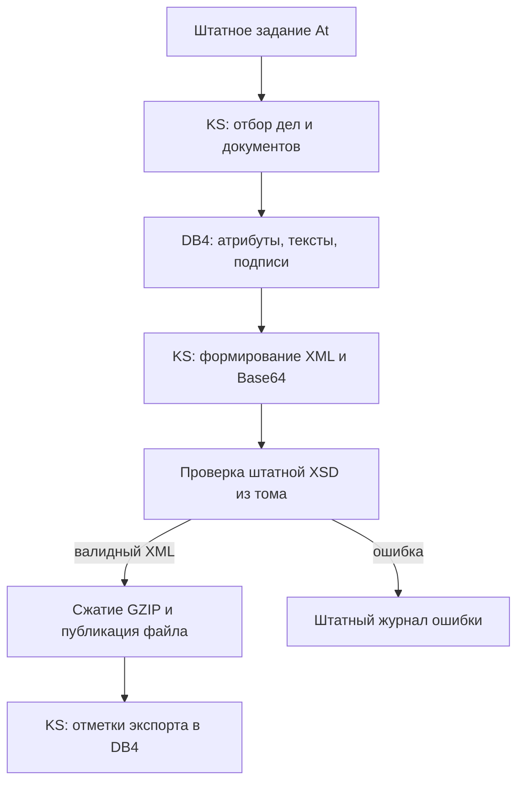

# Фоновая выгрузка БРАС в 0.30

Проверено 27 ноября 2026 года на полной копии контрольного комплекта с 49 подключёнными томами. Сравнение выполнено с обычным `kodweb.exe`.

## Причина ошибки

Задание `~mp_at` запускало штатную библиотеку обмена. В `mp_xml_createSchemaCache` она создавала `OLEobject("Msxml2.XMLSchemaCache.6.0")`. Этот объект не был реализован, поэтому обмен останавливался ещё до формирования XML.

В Codex-AIs добавлены объекты документа XML и кэша XSD. Они выполняются в Rust: COM и установленный MSXML для этой выгрузки не нужны. Поддержаны используемые библиотекой `loadXML`, `parseError`, `schemas`, `validate`, `add` и `remove`. Проверка схемы выполняется действительно; успешный ответ вместо проверки не подставляется.

При прохождении всего задания найдены и исправлены ещё четыре расхождения:

- Вложенный `Document.Execute` в фоновом задании получал устаревшую копию глобальных параметров. Режим экспорта мог завершиться без обработки дела. Контекст задания теперь видит актуальные параметры и импортированные функции.
- SQL-методы `getStream` и `_getStream` теперь возвращают двоичное поле и все его повторные значения. Base64 принимает и возвращает потоки, сохраняя байты RTF и подписей.
- Описания томов в `Application.Paths[].vol` учитывают `RedactN`. Ранее все такие описания сообщали «только чтение», включая рабочий том обмена. Проверки разрешения операции и доступности тома для записи сохранены.
- Запись XML и сжатие заменены в хостовом адаптере экспортёра. Готовый `.xml.gz` публикуется в настроенных каталогах до отметки об успешной выгрузке. Не требуются пакетный файл Windows и внешний `gzip.exe`.

## Путь данных

Схема, правила отбора и состав XML остаются в штатных томах. Номера дел, имена рабочих томов и идентификаторы объектов не зашиты в адаптер.

Файлы сначала полностью записываются и синхронизируются под временным именем. Получатель видит расширение `.xml.gz` после публикации готового архива. Существующий архив не перезаписывается. Изменения DB4 используют имеющийся журнал восстановления; весь обмен нескольких дел не является одной транзакцией.

## Сравнение одной полной выгрузки

| Показатель | kodweb | Codex-AIs |
|---|---:|---:|
| Время обработки дела по журналу экспорта | 66,591 с | 5,533 с |
| Успешно обработано дел | 1 из 1 | 1 из 1 |
| Элементов в XML | 1 244 | 1 244 |
| Вложенных текстов документов | 13 | 13 |
| Сохранённых электронных подписей | 3 | 3 |
| XML без сжатия | 2 174 174 байта | 2 175 037 байт |
| Архив GZIP | 549 481 байт | 551 896 байт |

Сравнены дерево XML, атрибуты, значения и порядок элементов. Различий в данных нет. Все 16 двоичных вложений совпали побайтно. Разница размеров связана с представлением XML и сжатием; побайтного совпадения самих архивов не требуется. Основной архив и его копия у Codex-AIs совпали побайтно.

Это один контрольный случай, а не оценка скорости любых дел или всей очереди обмена. Длительность взята из штатного журнала, без ожидания запланированного запуска. У kodweb внешнее сжатие запускается отдельным процессом; готовность его архива проверена дополнительно.

## Проверка XML

Использована штатная `xport_v7.xsd` размером 42 515 байт. Установленный MSXML 6 и Codex-AIs дали одинаковый результат на 24 вариантах: пять приняты, 19 отклонены. Среди них обе реальные выгрузки, допустимый иной порядок элементов `xs:all`, нарушения обязательных полей, типов, перечислений, фиксированных значений, пространств имён, лишние атрибуты и элементы, неверные Base64 текста и подписи.

XML Codex-AIs также успешно прошёл проверку в MSXML. Текст и числовой код диагностической ошибки двух валидаторов могут различаться.

## Автоматическое задание и регрессии

После перезапуска штатный `~mp_at` запустил `~brasExchangeTasks` без ручного вызова экспортёра. Задание обработало девять временных интервалов за 14,36 с, сохранило дату последнего успешного экспорта в `config.db4` и назначило следующий запуск. В этих интервалах не было изменённых дел: это проверка расписания и продвижения даты, а не повторный замер полной выгрузки.

Kodweb затем прочитал изменённые Codex-AIs тома и выполнил повторную выгрузку того же дела за 67,277 с. Полученный XML после распаковки совпал побайтно с первым результатом kodweb. Главная, форма обмена, диспетчер заданий и чтение RTF через Word также работали.

Итоговая сборка Codex-AIs повторно обработала это дело после kodweb за 5,060 с. Данные XML, тексты и подписи снова совпали с исходной выгрузкой; основная и резервная копии архива совпали побайтно.

Главная и протокол Word ответили успешно. Полученный через Word RTF и XLS отчёта 1АС за один день совпали побайтно с контрольными результатами до изменений. Пройдены 54 автоматических теста, отдельно — сравнение 24 XML с результатами MSXML. Пять тестов с внешними фикстурами пропускаются при обычном запуске тестов; XML-корпус выполнен отдельно.

## Объём совместимости

Реализована необходимая экспортёру часть MSXML, а не произвольная COM-автоматизация. Неподдержанные ограничения XSD и внешние `include`/`import` завершаются явной ошибкой. DTD и загрузка внешних сущностей отключены. Для сборки используются `oxml 0.0.13` и `xmlschema 0.0.14`; минимальная версия Rust — 1.89.

Эта проверка подтверждает формирование и сохранение выгрузки. Она не подтверждает доставку в производственный БРАС/КАД, SMTP/FTP, импорт входящих XML или криптографическую проверку передаваемых подписей. Долгие задания At по-прежнему выполняются у владельца KS; этот выпуск не переносит их в тяжёлый пул.
