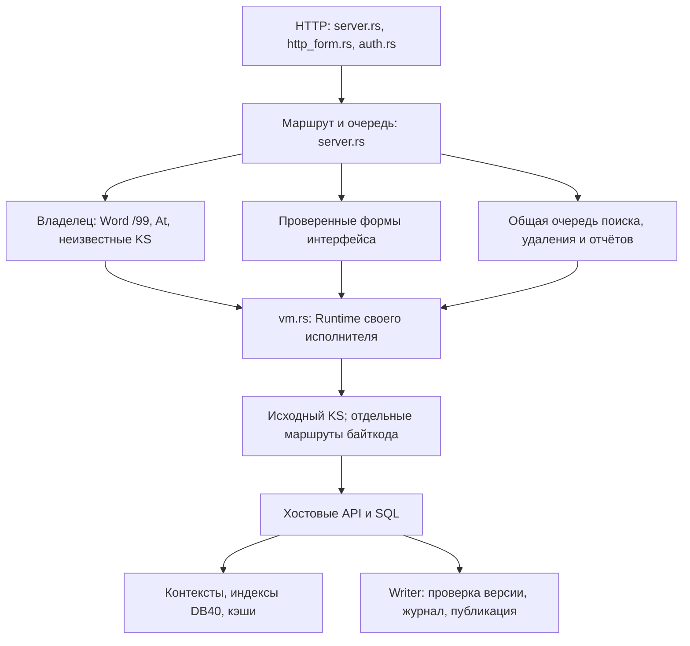

# Разработчику форка

Сверено с кодом **0.28.1**, 26 ноября 2026 года. Это руководство по текущему дереву исходников. Документы с номером версии описывают проверки соответствующего выпуска; их ограничения не всегда относятся к текущей версии. [Указатель документации](README.md).

## Начало работы

1. Соберите весь репозиторий: нужны `src/`, `Cargo.toml`, `Cargo.lock`, `build.rs` и `assets/`. Штатные KS и данные суда для компиляции не нужны. [Сборка и запуск](BUILD_AND_RUN.md).
2. Для исполнения форм нужен полный согласованный комплект данных. Подключения, схемы и порядок томов берутся из `config.db4`; состав папок `old` и `workbase` не фиксирован в программе.
3. Воспроизведите одну неисправность: версия EXE, URL и метод, роль пользователя, параметры, ожидаемый и фактический результат. Для публикации используйте обезличенный или синтетический пример.
4. Найдите слой расхождения: HTTP → маршрут/права → KS → хостовый метод → SQL → DB40. Ошибка 501 может означать неподдержанную операцию KS, ограничение формата или отсутствие реализации маршрута. Нужен её полный текст, а не только HTTP-статус.
5. После исправления повторите пользовательский сценарий. Для записи сравните атрибуты, текст, вложения и повторное чтение в kodweb. [Порядок проверок](TESTING.md).

Исправляйте семантику операции. Не зашивайте номер реального дела или набор томов одного суда. Самостоятельное расширение, например пакетный импорт KOD, может иметь новую форму; она не должна незаметно заменять штатный сценарий.

## Путь запроса

Runtime и изменяемые KS-объекты принадлежат конкретному исполнителю. Схема показывает общий путь вызовов, а не один Runtime для всех очередей. `/admin?status`, настройки Rust и некоторые административные обработчики имеют отдельные пути в `server.rs`, без обычной очереди KS.

## Карта модулей

| Где искать | Назначение |
|---|---|
| [main.rs](../src/main.rs), [product.rs](../src/product.rs), [listen_config.rs](../src/listen_config.rs) | CLI, версия, корень данных, адрес и порт |
| [server.rs](../src/server.rs), [http_form.rs](../src/http_form.rs), [http_stream.rs](../src/http_stream.rs), [auth.rs](../src/auth.rs) | HTTP, формы и загрузки, потоковый ответ, права, очередь |
| [worker_config.rs](../src/worker_config.rs), [execution.rs](../src/execution.rs), [monitor.rs](../src/monitor.rs) | Выбор пула при запуске, отмена, состояния запросов |
| [vm.rs](../src/vm.rs) | Каталоги, startup, обработчики и локальные Runtime |
| [ks/parser.rs](../src/ks/parser.rs), [ks/runtime.rs](../src/ks/runtime.rs), [ks/host.rs](../src/ks/host.rs) | Исходный KS, вычисления и хостовые функции |
| [ks/compiled.rs](../src/ks/compiled.rs), [ks/compiled_runtime.rs](../src/ks/compiled_runtime.rs) | Декодирование и исполнение поддержанной части байткода |
| [ks/database.rs](../src/ks/database.rs), [ks/sql.rs](../src/ks/sql.rs), [ks/sql_join.rs](../src/ks/sql_join.rs) | Контракт БД для KS, SQL и курсоры |
| [db/mod.rs](../src/db/mod.rs), [db/registry.rs](../src/db/registry.rs), [db/context.rs](../src/db/context.rs) | Конфигурация, подключения, видимость и приоритет томов |
| [db/mainkey.rs](../src/db/mainkey.rs), [db/indexed_query.rs](../src/db/indexed_query.rs), [db/free_text.rs](../src/db/free_text.rs) | Индексы, отбор и полнотекстовый поиск |
| [db/shared_query.rs](../src/db/shared_query.rs), [db/text_column.rs](../src/db/text_column.rs), [db/decoded_cache.rs](../src/db/decoded_cache.rs) | Общие результаты отбора и строковые колонки; отдельный кэш записей исполнителя |
| [db/name_cursor.rs](../src/db/name_cursor.rs), [db/context_pages.rs](../src/db/context_pages.rs), [basis_picker.rs](../src/basis_picker.rs) | Страницы P и подписи в выборе основания |
| [ks/document_fields.rs](../src/ks/document_fields.rs), [ks/document_write.rs](../src/ks/document_write.rs), [ks/attachment_files.rs](../src/ks/attachment_files.rs) | Атрибуты, потоки, запись через KS и вложения |
| [rich_text.rs](../src/rich_text.rs), [rich_text_rtf.rs](../src/rich_text_rtf.rs), [db/rtf_import.rs](../src/db/rtf_import.rs) | Внутренний текст CTF, экспорт и импорт RTF |
| [ks/form_doc.rs](../src/ks/form_doc.rs), [ks/form_list.rs](../src/ks/form_list.rs), [classifier_html.rs](../src/classifier_html.rs) | Карточки, списки и адаптация штатного HTML |
| [ks/xml_report.rs](../src/ks/xml_report.rs), [ks/xls_report.rs](../src/ks/xls_report.rs), [ks/report_rtf.rs](../src/ks/report_rtf.rs) | Отчёты, XLS-шаблоны, аншлаги для Word |
| [settings.rs](../src/settings.rs), [network_settings.rs](../src/network_settings.rs), [system_settings.rs](../src/system_settings.rs), [ks/system_settings.rs](../src/ks/system_settings.rs) | Настройки Rust, общий порт и штатные настройки config.db4 |
| [distribution.rs](../src/distribution.rs), [distribution_blocking.rs](../src/distribution_blocking.rs), [registration_settings.rs](../src/registration_settings.rs) | Распределение и регистрационные настройки |
| [kod_restore.rs](../src/kod_restore.rs), [kod_choices.rs](../src/kod_choices.rs), [kod_links.rs](../src/kod_links.rs) | Пакет KOD, конфликты, редакции, сравнение и связи |
| [db/writer.rs](../src/db/writer.rs), [db/writer_index.rs](../src/db/writer_index.rs), [db/writer_remove.rs](../src/db/writer_remove.rs) | Изменения DB40 и индексов, удаление, публикация |
| [db/writer_registry.rs](../src/db/writer_registry.rs), [db/writer_counters.rs](../src/db/writer_counters.rs), [db/writer_kod.rs](../src/db/writer_kod.rs) | Настройки, счётчики и импорт |
| [db/writer_journal.rs](../src/db/writer_journal.rs), [db/writer_snapshot.rs](../src/db/writer_snapshot.rs) | Undo/redo и прежние образы читателей |
| [ks/source_compat.rs](../src/ks/source_compat.rs), [ks/source_fingerprint.rs](../src/ks/source_fingerprint.rs), [static_cache.rs](../src/static_cache.rs) | Адаптеры KS и отдельный кэш готовой статики |

Файлы подключаются в том числе через `#[path]`: физический путь не всегда совпадает с именем Rust-модуля.

## Реализованное и оставшаяся работа

| Блок | Уже есть в 0.28.1 | Что расширять или проверять |
|---|---|---|
| KS | Исходный текст, хостовые API; частичный исполнитель байткода распределения | Другие инструкции. `render_record` включает байткод для `raspred_settings` и `Raspred_Del_Auto` без исходника; это не универсальное исполнение любого скомпилированного KS |
| Word `/99` | Шаблон и основание, сохранение, редакции, открытие, обычное подписание, доступ и разблокирование; импорт RTF во внутренний текст | Другие клиенты/шаблоны, конструкции RTF и современный клиент. Базовое сохранение и подписание уже не задачи с нуля |
| Электронная подпись | Сохранение/чтение подписи RTF, PDF и его подписи; серверный цикл сопоставлен с kodweb | Полный проход кнопками Word после исправления PDF, ГОСТ, токен, доверие к сертификату, отзыв и коллегиальное подписание. RSA-тест не подтверждает эти сценарии |
| Общие настройки | Сохранение 42 разделов контрольного комплекта, счётчики, пути хранилищ, порт HTTP в config.db4 | Другие схемы и KS. Сохранение параметров внешнего сервиса не реализует сам обмен |
| P и KOD | Создание/изменение/удаление, страницы, одиночный и пакетный импорт, выбор редакции/зависимостей и сравнение | Пакет по нескольким томам, импорт исполняемых KS и другие варианты штатных форм |
| Отчёты | XLS без серверных Excel/MSXML, формулы для клиентского пересчёта; почтовый отчёт отдаёт строки по мере расчёта | Другие формы, оптимизация измеренных узких мест, согласованный снимок на время отчёта |
| Пул и кэши | `workers=auto`, ручной выбор, общая тяжёлая очередь, помощь интерфейсу, общие результаты и строковые колонки, кэш статики | Изоляция долгих At от Word, новые проверенные маршруты, расход памяти на других комплектах |
| DB40 | Страничный журнал, резерв, закрепление читателей; документы, настройки, пользователи, KOD | Большие изменяемые тома без полного образа, транзакция каскада, произвольные полнотекстовые индексы |

Объём проверок: [Word](WORD_TEMPLATES_0.25.md), [ЭП](WORD_SIGNATURE_0.25.md), [настройки](SYSTEM_SETTINGS_0.27.md), [KOD](KOD_RESTORE_0.28.md), [RTF](RTF_IMPORT_0.27.md), [почтовый отчёт](POSTAL_REPORT_0.26.md).

## Инварианты совместимости

**Данные.** Штатные тексты и ответы используют CP1251, новые административные страницы — UTF-8. Двоичные потоки не перекодируются. Сохраняйте порядок повторных полей, точные денежные значения и различие пустого значения и нуля. Частичный SQL-результат нельзя выдавать за полный. Маркер удаления должен скрывать старую архивную запись.

**Адаптеры.** В `source_compat.rs` многие изменения проверяют SHA-256 текста или фрагмента. В `vm.rs` и обработчиках HTML есть также преобразования по имени формы и содержимому без общего контроля отпечатка. Не считайте все адаптеры автоматически совместимыми с любым KS. Новое исключение ограничивайте проверенным вариантом, проверяйте путь без совпадения. Том исходного KS при такой адаптации не переписывается.

**Маршрутизация.** `server.rs::lane` выбирает группу запроса. GET сам по себе не означает отсутствие изменений. Word, регистрация пользователей и фоновые очереди остаются у владельца. Перенос на реплику требует проверки глобального состояния, прав и At; `Rc/RefCell` между исполнителями не передаются. Не держите блокировку общего кэша во время I/O или вычислений. Кооперативная отмена нужна и в новых длительных хостовых API.

**Кэши.** Общие результаты привязаны к каталогу данных, контексту и поколению тома; восстановление журнала тоже меняет поколение. Старый построитель не должен заполнить кэш новой версии. Кэш декодированных записей не общий для всех исполнителей. `static_cache.rs` хранит CSS/JS/изображения, не HTML персональных карточек; проверка доступа выполняется и при попадании в кэш.

**Редактор атрибутов.** С 0.25.1 карточка P не проверяет версию с момента открытия. KS читает актуальный объект при отправке формы и применяет присланные поля; старая вкладка может перезаписать эти поля. Проверка версии непосредственно во время записи DB4 сохраняется. Список KOD и общие настройки имеют собственные проверки конфликтов. Не переносите ожидания одной формы на другую. [Поведение редактора](P_AREA_0.22.md#сохранение-атрибутов-с-0251).

**Страницы и основание.** `NameCursor`/`ObjectPages` сохраняют порядок нативных ключей. Число строк может отличаться от числа уникальных OID; безусловное удаление повторов ломает совместимость. Подпись основания — только отображение: в атрибут возвращается прежняя ссылка.

**Пакет KOD.** Совпадения проверяются попарно: одинаковый номер, имя в одной области, удаление номера другого файла заменой. Не объединяйте цепочку совпадений в группу с единственным вариантом — крайние файлы могут быть совместимы. `kod_links.rs` показывает связи выбранных файлов, а не все обратные ссылки базы. Перед записью обязательны повторные проверки в `writer_kod.rs`.

## Запись и восстановление

`MUTATIONS` согласует изменение томов внутри процесса; `PUBLICATION` защищает публикацию и регистрацию читателей. Подготовка ещё создаёт полный образ тома. Предел изменяемого образа — **256 МиБ**, обход MainKey при подготовке ограничен **1 000 000 записей**. Это не лимиты чтения архивов, поиска или KS-инструкций.

Малое изменение публикуется страницами с undo/redo, большое — заменой файла. До фиксации сохраняется прежний образ и резерв; открытые читатели удерживают свои версии. [Протокол записи](DB40_WRITES.md) описывает точки синхронизации и восстановление после сбоя.

Единица фиксации — **изменение одного тома**: оно может включать несколько записей KOD или настроек. Каскад удаления состоит из нескольких таких операций; ошибка или отмена не откатывает сохранённую часть. Общего снимка всех томов на время отчёта нет. Не снимайте блокировку публикации ради параллельной перезаписи одного файла.

Импорт RTF и сохранение внутреннего текста уже реализованы. Неподдержанная **перезапись непустого CTF-индекса** в `writer_index.rs` — отдельное ограничение, а не запрет на любой внутренний текст. `writer_user_index.rs` обновляет словарь проверенной пользовательской схемы DB40 6.12; его нельзя переносить на произвольные документы. Для словарных блоков kodweb требует тип `S`: чтение собственного результата Rust недостаточно.

## Команды диагностики

Синтаксис соответствует `main.rs`; на Windows используйте путь к `codex-AIs.exe`.

| Команда | Что даёт |
|---|---|
| `codex-AIs --version` | Версия бинарника |
| `codex-AIs check-ks FILE utf8` | Разбор синтетического KS без базы; доступна также кодировка `cp1251` |
| `codex-AIs run-ks FILE utf8` | Исполнение в пустом тестовом Runtime, без startup и хостовых объектов настоящего каталога |
| `codex-AIs inspect-schema VOLUME_PATH [AREA_NAME_OR_ID]` | Схема тома |
| `codex-AIs inspect-oid VOLUME_PATH OID` | Атрибуты записи |
| `codex-AIs inspect-links VOLUME_PATH OID` | Диагностика связей записи |
| `codex-AIs inspect-sql DATA_ROOT VIRTUAL_DIR SQL_FILE OUTPUT [MOUNTS_FILE]` | Общий счётчик и до 1000 строк. Startup не исполняется; дополнительные тома задаются файлом подключений |
| `codex-AIs audit-local-paths DATA_ROOT` | Пути внешних ресурсов из конфигурации |
| `codex-AIs recover DATA_ROOT` | Восстановление журналов при остановленных серверах; команда изменяет данные |

Вывод с реальными томами может содержать данные суда. Для публичного issue нужен минимальный пример. `KODEKS_TRACE=1` помогает локализовать загрузку KS, `KODEKS_PROFILE=1` — стоимость функций; время с профилированием измеряйте отдельно от обычного запуска.

## Проверки и выпуск форка

В публичном дереве нет прежнего исследовательского набора тестов и его фикстур. Нулевой результат `cargo test` не подтверждает совместимость. Добавляйте синтетические тесты на изменённую семантику и повторяемые HTTP-сценарии без судебных данных и штатных KS.

Минимальная сборочная проверка: `cargo check --locked`, затем `cargo build --release --locked`. `--offline` подходит при заполненном кэше зависимостей. Форматирование дерева неоднородно: в 0.28.1 `cargo fmt --check` выявляет существующие отличия. Не смешивайте массовое форматирование со смысловым исправлением; проверяйте свой участок и указывайте состояние проверки.

Для нового пути записи нужны конфликт версии, сбои на стадиях журнала, повторное восстановление, прежние читатели и чтение оригиналом. Для очереди — права, отмена, At и параллельный запрос. Для отчёта — строки, значения и формулы, а не только время или размер XLS.

Сборка Linux/FreeBSD не заменяет проверку форм и записи на целевой ОС. Новые сетевые настройки 0.28.1 проверены на Windows x64.

К бинарнику форка приложите соответствующие исходники с `Cargo.lock`, `build.rs`, `assets/`, лицензией и сведениями о зависимостях. Обновляйте `SHA256SUMS` по байтам публикуемого дерева Git, отдельно считайте суммы артефактов. Укажите commit и объём проверок. [Правила PR](../CONTRIBUTING.md).
