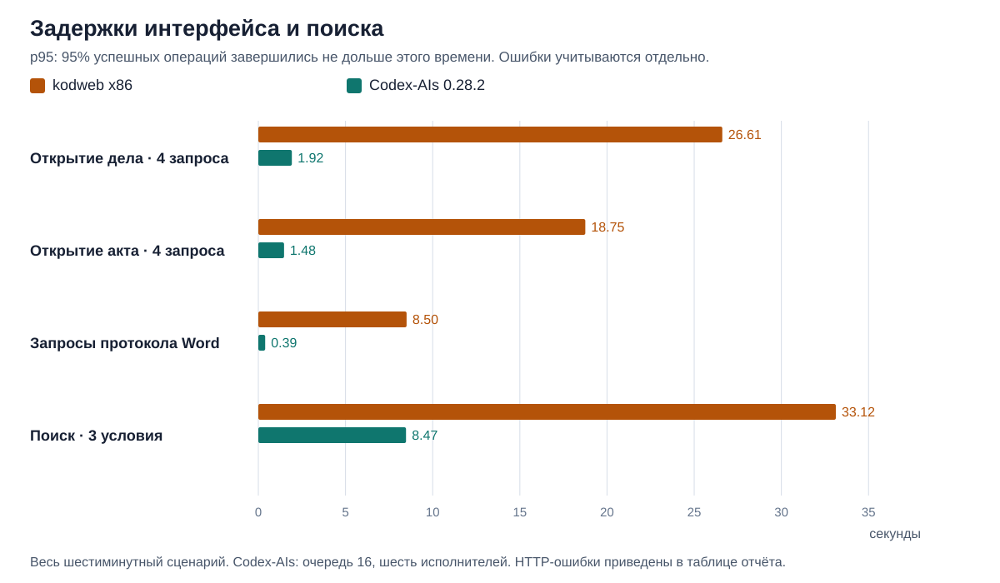
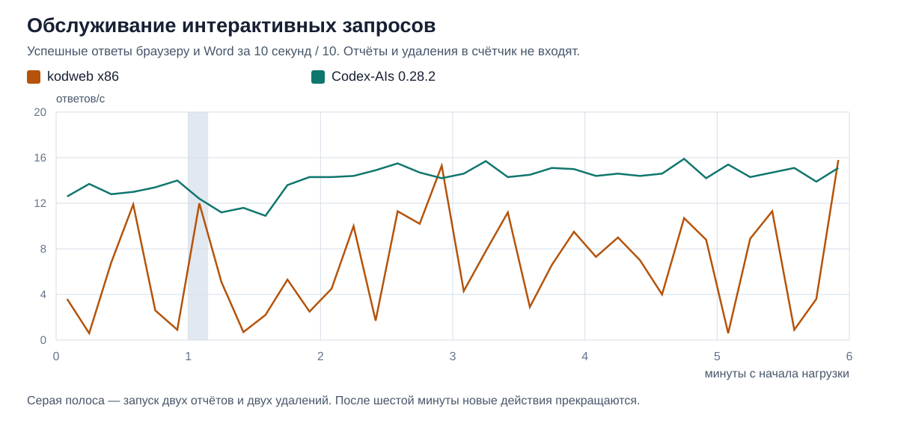
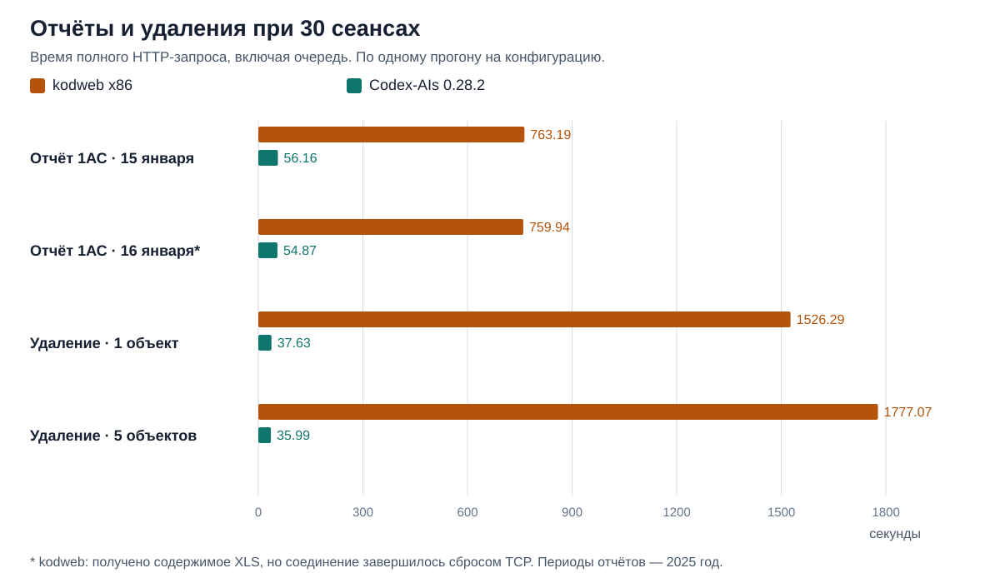
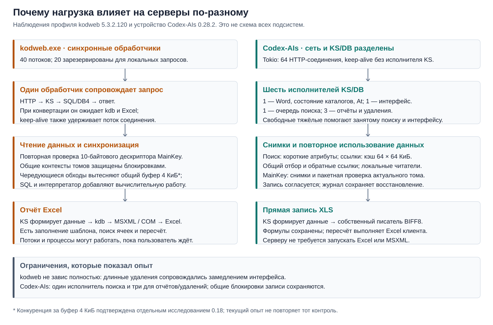

# Смешанная нагрузка: 30 сеансов kodweb и Codex-AIs

26 ноября 2026 года. Сравнение `kodweb.exe` 5.3.2.120 x86 и реализации Codex-AIs, вошедшей в **0.28.2**. [Агрегированные измерения и контрольные суммы измеренных EXE](mixed-load-0.28.2.json). Версия выпуска присвоена после нагрузочной проверки; контрольные суммы опубликованных файлов находятся в `SHA256SUMS` в Releases.

В этом опыте kodweb **не завис полностью**, но два удаления выполнялись 25–30 минут, а открытие дела иногда занимало десятки секунд. В Codex-AIs оба запроса удаления завершились за 36–38 секунд каждый, включая ожидание в очереди. Под смешанной нагрузкой p95 поиска составил **8,47 с** у Codex-AIs и **33,12 с** у kodweb; максимум — **21,80 и 47,29 с** соответственно.

Codex-AIs обработал **5 081 запрос без ошибок** при шести исполнителях KS/DB, лимите очереди 16 и 64 слотах HTTP. Ниже приведены задержки интерфейса, отчётов и удалений, расход ресурсов и проверка совпадения данных.

Это результаты одного сценария на одном комплекте, а не оценка предельного числа пользователей. Преимущество связано с алгоритмами чтения, исполнением запросов и формированием XLS; выбор языка сам по себе не обеспечивает такие времена.

## Что имитировалось

Использована полная независимая копия комплекта с 49 зарегистрированными томами. Перед каждым основным прогоном данные возвращались к одному исходному снимку, содержащему 30 отдельных тестовых учётных записей. Архивные документы читались из настоящих томов, а новые документы Word записывались в рабочий том.

| Сеансы | Действия |
|---|---|
| 20 браузерных | Главная, карточка дела, список документов, судебный акт, его текст; шесть сеансов также выполняли поиск |
| 6 Word | Получить шаблон определения, найти дело и основания, создать документ, сохранить RTF, открыть, изменить, сохранить, подписать без ЭП и снова открыть |
| 2 отчётных | «Отчёт о работе суда ф.1АС» за 15 и 16 января 2025 года, `/20a?StatOtchet221` |
| 2 удаления | «Удалить все объекты» с отметкой удаления и экспортом `.kod`: один объект и каскад из пяти объектов |

Нагрузка шла **шесть минут**. Отчёты и удаления запускались на 60-й, 63-й, 66-й и 69-й секундах; создание документов Word — в той же части опыта. Между действиями выдерживалась пауза 2–4 секунды. После шестой минуты новые действия не начинались, но уже отправленные запросы ожидались до завершения. Поэтому последние минуты длинных операций kodweb проходили уже без полной интерактивной нагрузки.

Это 30 HTTP-сеансов с запросами протокола установленной надстройки `spdas`, **не 30 запущенных экземпляров Word**. Отрисовка окон, работа макросов на клиентах, ЭП, токены и задержки внешней сети здесь не измерялись. Все шесть новых документов относились к одному делу, но сохранялись разными пользователями в разные объекты. Такой выбор создаёт конкуренцию за общие данные дела. Он не представляет все варианты работы Word.

Чтение интерфейса использовало небольшой повторяющийся набор дел и документов. В поиске чередовались три условия: связанный поиск дел и документов по слову «московский», а также FREETEXT по слову «ТЮМЕНЬ», по 20 строк на странице. Это проверка одновременно холодного поиска и повторного использования данных, а не равномерная случайная выборка всех документов базы.

## Среда и настройки

Windows Server 2025, build 26100; доступно 6 ядер / 12 логических процессоров Intel Xeon Silver 4516Y+, 32 ГиБ памяти. Клиент нагрузки работал на том же компьютере через loopback. Серверы запускались заново; перед отсчётом выполнялось короткое открытие главной, списка дела и проверка соединения Word. Файловый кэш Windows не очищался.

| Параметр | kodweb | Codex-AIs 0.28.2 |
| --- | ---: | ---: |
| Потоки / исполнители KS/DB | 40 синхронных обработчиков | 6, выбор `auto` |
| Резерв kodweb для локальных соединений | 20 | — |
| Слоты HTTP Codex-AIs | — | 64 |
| Ожидающие запросы KS Codex-AIs | — | 16 + 2 резервных |
| Исполнители тяжёлых запросов Codex-AIs | Общий пул | 1 поиск + 3 отчёты/удаления |
| Keep-alive, с | 10 | 60 |

Два резервных места Codex-AIs предназначены для владельца/Word и интерфейса. Это места **в очереди**, не дополнительные исполнители. При шести исполнителях один обслуживает владельца/Word, один — интерфейс, один — поиск и три — отчёты и удаления. Настройки выбраны при запуске; автоматического изменения размера пула во время опыта нет.

На каждую конфигурацию выполнен один основной прогон. Порядок измерений — kodweb, затем Codex-AIs. Перед тяжёлой операцией клиент открывал новое соединение; автоматических повторов записывающих запросов не было.

Кэш ОС, порядок запусков и различное чередование запросов влияют на результаты. Эта серия не определяет универсальный оптимум числа исполнителей или длины очереди.

## Скорость и ошибки

Здесь p95 — время, за которое закончились 95% **успешных** запросов соответствующей группы. Ошибки не превращались в «быстрые ответы» при подсчёте задержки. Время включает передачу ответа; для полного открытия дела и акта суммируется последовательность `d → bar → hdoc → doc`, без отрисовки браузером.

| Показатель | kodweb | Codex-AIs 0.28.2 |
| --- | ---: | ---: |
| Всего HTTP-запросов сценария | 2 380 | 5 081 |
| Успешные интерактивные ответы за первые 360 с | 2 374 | 5 073 |
| p95 полного открытия дела, с | 26,61 | 1,92 |
| p95 полного открытия акта, с | 18,75 | 1,48 |
| p95 запросов протокола Word, с | 8,50 | 0,39 |
| p95 поиска, с | 33,12 | 8,47 |
| Максимум поиска, с | 47,29 | 21,80 |
| Успешные обычные подписи с первой попытки | 4 из 6 | 6 из 6 |
| Ошибки в основном прогоне | 2 HTTP 500 при подписи; 1 сброс TCP при XLS | 0 |

Это замкнутый сценарий: пользователь начинает следующее действие после ответа и паузы. Более быстрый сервер успевает получить больше действий. Поэтому число запросов не одинаково, а отношение этих чисел не является ускорением фиксированного пакета работ.

У kodweb были и очень быстрые ответы: медиана отдельного запроса интерфейса — 0,017 с, у Codex-AIs — 0,056 с. Медиана полного открытия дела — 1,02 и 0,67 с соответственно. Преимущество Codex-AIs в этом опыте относится прежде всего к длительным задержкам и завершению тяжёлых операций, а не ко всем ответам подряд.





### Почему у kodweb провалы и скачки, а у Codex-AIs линия ровнее

График показывает число **завершённых успешных ответов**, усреднённое за десять секунд. Когда много клиентов ждут, ответов мало и линия падает. Когда задержанные запросы завершаются группой, а клиенты отправляют следующие, линия поднимается. Открытие карточки состоит из нескольких последовательных HTTP-запросов, поэтому после долгого ожидания за одним ответом могут быстро пройти ещё несколько.

В журнале kodweb виден такой пример:

| Интервал от начала нагрузки | Успешных интерактивных ответов | Ответов в секунду | Среднее число интерактивных клиентов, ожидающих ответа |
|---|---:|---:|---:|
| 10–20 с | 6 | 0,6 | 25,38 |
| 30–40 с | 119 | 11,9 | 1,82 |

Среднее число ожидающих в последнем столбце рассчитано для 20 браузерных и шести Word-сеансов по времени между отправкой запроса и получением ответа. Это клиентское ожидание, а не число занятых потоков сервера.

Около 26,48-й секунды почти одновременно завершились 13 запросов панели документа и шесть запросов Word. За ними быстро прошли следующие запросы карточек: всего за интервал 26,47–26,51 с получено 30 ответов. Это наблюдаемое накопление и групповое завершение запросов. Первые такие провалы возникли **до запуска отчётов и удалений**, которые начинались с 60-й секунды.

Профиль kodweb подтверждает конкуренцию за защищённые контексты томов, ожидания блокировок и частые повторные чтения дескрипторов MainKey. Эти механизмы согласуются с задержками, но точная причина каждого провала не установлена. Окно ETW смешанной нагрузки охватывает примерно 155,45–176,62 с и не содержит приведённый ранний эпизод. Поэтому его нельзя приписывать конкретной блокировке только по этому профилю. Исчерпания всех 40 обработчиков в основном прогоне также не зафиксировано. [Наблюдения профиля](#где-kodweb-тратит-время).

У Codex-AIs обычные ответы чаще завершались быстро, а паузы пользователей по 2–4 секунды распределяли следующие обращения по времени. Отдельные исполнители интерфейса и поиска, общие кэши и чтение атрибутов без загрузки полного текста ограничивают влияние тяжёлых задач. Ровная линия относится к этому сценарию с небольшим повторяющимся набором документов; она не гарантирует такую же картину при любой нагрузке.

### Отчёты и удаления

| Операция | kodweb, с | Codex-AIs 0.28.2, с |
| --- | ---: | ---: |
| Отчёт 1АС за 15 января | 763,19 | 56,16 |
| Отчёт 1АС за 16 января | 759,94* | 54,87 |
| Удаление одного объекта | 1 526,29 | 37,63 |
| Удаление каскада из пяти объектов | 1 777,07 | 35,99 |

\* Клиент получил заголовок HTTP 200 и содержимое XLS, затем зарегистрировал сброс TCP. Сохранённое тело оказалось разбираемой книгой и прошло сравнение ячеек. Время приведено как наблюдаемое время запроса с транспортной ошибкой, а не как успешное скачивание. Этот результат сам по себе не устанавливает, что увидел бы пользователь конкретной версии браузера.

Небольшой каскад не означает небольшую работу: штатное удаление ищет обратные ссылки в других областях и томах. Оба сценария удаляли реальные архивные объекты, а не искусственно созданные пустые записи.



### Почему запрос на пять объектов занял меньше времени

В таблице измерено время от отправки HTTP-запроса до получения ответа, **включая очередь**. Пять объектов удалялись одним каскадным запросом, а не пятью независимыми запросами.

| Запрос Codex-AIs | Отправлен на секунде | Ответ получен на секунде | Полное время запроса |
|---|---:|---:|---:|
| Удаление одного объекта | 66,00 | 103,63 | 37,63 с |
| Удаление каскада из пяти объектов | 69,00 | 104,99 | 35,99 с |

**Второе удаление ждало в очереди.** Два из трёх тяжёлых исполнителей были заняты отчётами, третий выполнял первое удаление. В снимке `/admin?status` на 101,47-й секунде первый запрос ещё исполнялся, а второй стоял в очереди. Затем оба удаления последовательно прошли через исполнителя № 5; второй запрос завершился вскоре после первого.

Запрос на пять объектов отправили на 3 секунды позже, а ответ получили всего на 1,36 секунды позже. Поэтому его полная длительность оказалась на 1,64 секунды меньше. Интервал между ответами нельзя считать точным замером чистого расчёта второго удаления: статус опрашивался раз в пять секунд, а клиентское время включает передачу ответа.

Повторное использование уже открытых томов и подготовленных кэшей могло помочь второму запросу, но отдельный вклад этого эффекта не измерялся. Кроме того, объекты различаются связями и необходимыми изменениями базы. Эта пара не доказывает, что удаление пяти объектов вообще быстрее удаления одного, и не является сравнением двух удалений в одинаковых условиях без ожидания.

### Память, CPU и чтение

| Счётчик за весь прогон | kodweb и дочерние процессы | Codex-AIs 0.28.2 |
| --- | ---: | ---: |
| Время от начала нагрузки до последнего ответа, с | 1 846,64 | 364,68 |
| Суммарное процессорное время, с | 3 450,39 | 648,55 |
| Пик суммы частной памяти процессов, ГиБ | 1,51 | 2,39 |
| Логические чтения самого сервера, млн | 10,43 | 9,25 |
| Прочитано самим сервером, ГиБ | 30,07 | 33,77 |

CPU — сумма работы всех потоков, поэтому процессорное время может превышать длительность опыта. У kodweb сюда вошли около 2 934 с самого сервера, 69 с двух процессов kdb и 447 с двух Excel. Короткие интервалы жизни дочерних процессов между секундными замерами могли не попасть в счётчик полностью.

Логические чтения получены через счётчики процесса: это не физические обращения к накопителю. Они могут обслуживаться кэшем Windows. Codex-AIs выполнил меньше операций чтения, но прочитал больше байтов. При отборе по атрибутам он не распаковывает тексты и обрабатывает номера объектов по томам. Несколько состояний исполнителей и кэши требуют дополнительной памяти.

Объём выполненных интерактивных действий и длительность наблюдения различаются. Таблица ресурсов описывает весь конкретный опыт; это не сравнение CPU или памяти на один и тот же фиксированный набор запросов.

## Проверка содержимого

- Все шесть документов каждого основного прогона повторно прочитаны через Word-протокол. RTF после правки совпал с отправленным текстом по SHA-256. В kodweb два первоначально неудачных подписания затем успешно выполнены последовательно за 0,34 и 0,37 с; это отдельная проверка, не исправление статистики основного прогона.
- Оба каскада дали ожидаемые шесть `.kod`. Декодированные данные всех шести файлов совпали между kodweb и Codex-AIs; три архива совпали также побайтно. Отсутствие шести объектов проверено SQL-запросами по четырём областям, с положительным контролем на существующем документе.
- В каждой книге 13 листов. Совпали 37 947 проверяемых ячеек без формул, порядок и названия листов, а также семантика 17 250 формул. Это сравнение структуры и данных книги, не визуальная проверка всех параметров печати.
- У книг Codex-AIs отличаются кэшированные результаты 17 и 29 формул: сервер сохраняет формулы для пересчёта клиентом. Текущий опыт не включает время открытия и пересчёта в Excel клиента. Это отличие нельзя скрывать в сравнении с kodweb, который запускает Excel на сервере. [Отдельная проверка пересчёта](PROFILING_0.18.md).
- Первые выдачи поиска содержали одинаковые счётчики: 11 174 дела, 35 341 документ, 2 909 результатов FREETEXT. В отдельной проверке страницы 1, 2 и 100 всех трёх условий совпали с kodweb полностью: 180 строк, их порядок, аннотации и веса. Полный порядок всех десятков тысяч строк не сравнивался.

### Отдельный контроль подписания kodweb без тяжёлых задач

Для kodweb дополнительно подготовлены шесть новых документов одного дела. Три подписывались одновременно, три других — последовательно, без отчётов и удалений. Использованы тот же шаблон и разные учётные записи.

При одновременной подписи прошёл один запрос из трёх, два вернули HTTP 500. Последовательно все три подписи прошли за 0,29–0,34 с каждая; повтор двух неудачных также завершился успешно за 0,28 и 0,39 с.

Ошибка kodweb воспроизводится при одновременном подписании даже без общей тяжёлой нагрузки. Штатный `signdoc` обновляет данные статистической карточки и дела; конкуренция за эти общие записи — правдоподобное объяснение. Но ответ содержит только `Internal server error`: точное исключение и конкретная конфликтующая запись не установлены. Документы разных дел в этом контроле не проверялись. Результат Codex-AIs в основном смешанном сценарии — шесть успешных подписей из шести.

### Keep-alive и занятость обработчиков

Отдельно открыты и удержаны 30 соединений kodweb после получения небольшого RTF. Через loopback сервер ответил всем 30 клиентам. В статусе зафиксированы **30 строк `KeepAlive`**, то есть 30 обработчиков продолжают сопровождать уже обслуженные соединения. В реализации Codex-AIs ожидание следующего HTTP-запроса отделено от KS/DB и обслуживается Tokio.

При немедленном повторе через сетевой адрес того же компьютера у kodweb три соединения получили `ConnectionRefusedError`. В поздней проверке с интервалом открытия 30 мс все 30 успешно подключились. Причина краткого отказа отдельно не изолирована. Это не опыт с отдельного удалённого компьютера и не доказательство того, как для него будет применён резерв локальных потоков. В основном смешанном прогоне исчерпание пула не установлено.

## Где kodweb тратит время

### Многократная проверка корня MainKey

В окне трассы Windows длительностью 21,169 с зарегистрировано **453 485 логических чтений** процесса kodweb. Из них **356 261, или 78,56%, имели размер всего 10 байт**. Это доля операций, не доля времени или прочитанных байтов.

Для семи рабочих томов повторные смещения сопоставлены с каталогом индексов `K` в сохранённых DB4. Они указывают на дескриптор корня **MainKey** — индекса внутренних номеров объектов:

| Том | Чтений того же 10-байтового дескриптора |
|---|---:|
| `work.db4` | 50 453 |
| `workptkviv.db4` | 50 391 |
| `work_participant.db4` | 50 391 |
| `workmt.db4` | 50 391 |
| `workpost.db4` | 50 390 |
| `workhistory.db4` | 50 390 |
| `jmail.db4` | 50 390 |

Проверка машинного кода и стеки CPU показывают следующий путь. Описания функций восстановлены по поведению; отладочных имён kodweb нет. Адреса относятся только к EXE с контрольной суммой из JSON.

```text
0x005cc700: получает защищённый контекст индекса
    → виртуальная проверка обновления
    → 0x005cb270 / 0x005cb020
         прочитать 10-байтовый дескриптор
         сравнить сохранённую версию
         при изменении сбросить состояние индекса и принять новый корень
```

В `0x005cb020` есть чтение длины `0x0a`, сравнение двухбайтового значения с сохранённым, сброс состояния через `0x005caec0` и обновление указателя корня. При уже загруженном индексе определённый флаг тома позволяет пропустить проверку; массовые чтения наблюдались именно на рабочих томах. В том же окне стеки этой функции встречались у потоков двух отчётов и трёх поисков.

Проверка версии нужна для согласованного чтения изменяемого тома. Выявленная лишняя работа — очень частое повторение одной небольшой проверки, а не сам факт проверки. Даже попадание в файловый кэш не отменяет вызовов, смены позиции, синхронизации и переходов в ядро. Отдельный замер ускорения всего kodweb после устранения этих чтений не проводился; приписывать им 78,56% длительности нельзя.

### Конкуренция за контексты томов

В том же коротком окне два потока удаления провели на CPU примерно 6,03 и 5,86 с, а в наблюдаемых состояниях ожидания — 13,38 и 13,53 с. В стеке видны обёртки захвата и освобождения критической секции `0x006e52b0` / `0x006e52d0`. Снимки цепочек ожидания WCT дополнительно показывают ожидание mutex, принадлежащих другим потокам. Полный вклад каждого объекта синхронизации в длительность удаления здесь не разделён.

Ранее отдельный причинный опыт установил, что два обхода вытесняют данные общего буфера тома размером 4 КиБ. Привязка kodweb к одному логическому CPU почти убрала прирост чтений именно той пары. [Измерения, функции и границы вывода](READ_AMPLIFICATION_0.18.md). Это дополнительное подтверждение механизма конкуренции, а не повторный контроль нынешней смешанной серии.

### KS, SQL и Excel

У потоков отчётов профиль содержит разрешение имён KS (`0x0076c970`), операции с битовыми наборами, выделение и копирование памяти. При конвертации появились два kdb и два Excel, а обслуживающие запросы потоки kodweb оставались заняты. Связь HTTP, KS/DB и ожидания конвертера в одном обработчике также установлена [предыдущей проверкой Thread ID](KODWEB_THREADS_0.18.md).

В отдельном окне поздней стадии поток со статусом `Command` использовал почти одно ядро: 20,17 с CPU за примерно 21 с. Среди горячих операций были подсчёт битов (`0x00615720`), блокировки и преобразование текущей даты. Назначение этой фоновой команды не установлено; её нельзя уверенно назвать очисткой кэша или конкретным заданием At.

Затраты штатной конвертации включают поиск ячеек шаблона, обращения COM, MSXML и пересчёт Excel. [Предыдущие отдельные опыты](KODWEB_CAUSES_0.18.md) показывают ускорение при готовом списке адресов ячеек и одном пересчёте. В текущем смешанном прогоне исходный конвертер работал штатно.

### Что не подтверждено

Монитор `/admin?status` отвечал во всех 367 наблюдениях kodweb; самый долгий ответ — 0,14 с. Не зафиксированы падение процесса, доказанный deadlock или исчерпание всех 40 потоков. Поэтому этот опыт объясняет часть замедлений под нагрузкой, но не устанавливает причину любого зависания конкретного сервера, в том числе повторяющегося каждые 20 минут.

## Что меняет модель Codex-AIs



1. **Сеть отделена от исполнения KS/DB.** Tokio обслуживает ожидание HTTP; keep-alive не занимает исполнителя. Владелец состояния/Word и интерфейс имеют свои исполнители, один исполнитель выделен поиску и три — отчётам и удалениям. Это уменьшает влияние отчётов на открытие карточек, но не исключает общие блокировки записи и конкуренцию за CPU.
2. **Чтение опирается на снимки состояния томов.** Компонент чтения загружает каталог индексов и корень MainKey при открытии тома; запись согласованно обновляет состояние и кэши. [MainKey](../src/db/mainkey.rs), [модель записи и снимков](DB40_WRITES.md). Не требуется перечитывать один дескриптор перед каждым обращением к тому.
3. **Результаты части запросов общие.** Отбор, обратные ссылки и строковые колонки могут повторно использоваться исполнителями; недостающий результат строит один исполнитель. Файловые позиции и кэш страниц остаются локальными. Это не общий изменяемый курсор тома и не отмена проверок доступа. [Общий кэш](../src/db/shared_query.rs).
4. **XLS формируется непосредственно.** Сервер не запускает Excel и не выполняет тысячи обращений к его объектной модели. Формулы остаются в книге и пересчитываются клиентом. Это перенос части работы, который учитывается в границах замера.
5. **Записывающие вызовы Word идут через одного владельца.** Одновременные запросы пользователей обрабатываются последовательно на этом участке. Это ограничивает пропускную способность Word, но также уменьшает конкуренцию отдельных вызовов за общую карточку дела. Целый многошаговый клиентский сценарий при этом не становится одной транзакцией.

### Что изменено в поиске

В Codex-AIs 0.28.2 поиск получает отдельную очередь и читает атрибуты без загрузки полного текста документа. Это сокращает вычислительную работу и отделяет ожидание поиска от очереди отчётов и удалений.

Устройство поиска:

- При четырёх и более исполнителях номер 3 обслуживает отдельную очередь поиска. Он не начинает отчёты или удаления. Остальные тяжёлые исполнители помогают занятому поиску, когда их очередь пуста. Последовательные запросы остаются у свободного выделенного исполнителя, чтобы повторно использовать его данные.
- Для скалярных условий SQL и сортировки читаются начальные атрибуты записи. Предикаты над текстовыми/бинарными потоками используют полный декодер. Неканонический порядок полей также возвращает полный путь чтения.
- Проверка актуального тома выполняется по группам внутренних номеров через MainKey, с чтением атрибутов в порядке томов. Сохраняются обратный порядок томов, отметки удаления и проверка принадлежности записи области. Ранжирование FREETEXT и передача веса по связям не изменены.
- Для разового отбора читается префикс до 2048 байт полезных данных, при необходимости расширяемый до конца атрибутов. Чтение каждой редкой записи не загружает страницу 64 КиБ; прежний кэш страниц для ссылок и метаданных сохранён.
- Проекция атрибутов имеет отдельный тип и не попадает в кэш полных документов или в модуль записи DB4. Протокол записи и восстановления после сбоя не менялся.

| Последовательная диагностическая серия после запуска процесса | Codex-AIs, с |
|---|---:|
| Дела: «московский» | 8,88 |
| Документы: «московский» | 3,69 |
| FREETEXT: «ТЮМЕНЬ» | 2,07 |
| FREETEXT из двух распространённых слов, 176 762 результата | 16,67 |

Это отдельная проверка с диагностикой SQL/KS, не времена 30-пользовательского прогона. Только первая операция начинается с пустыми кэшами процесса; последующие используют уже прочитанные данные. Кэш ОС не очищался. В широком запросе использованы слова «судебное поручение» в режиме FREETEXT, а не позиционный поиск точной фразы. Повтор трёх основных условий занимал 0,32–0,38 с.

Самый долгий поиск под нагрузкой занял 21,80 с. Монитор с шагом пять секунд ограничивает его ожидание интервалом 18,32–21,80 с. Короткие ожидания могут целиком попасть между опросами.

При шести исполнителях отчёты и удаления одновременно занимают не более трёх. Непрерывный поток поисков, длинная форма интерфейса на помощнике или занятая публикацией запись всё ещё могут увеличить задержку. При одном–трёх исполнителях отдельного резерва поиска нет.

### Оставшиеся ограничения

- В данном прогоне с очередью 16 ошибок не было. Универсальный оптимум очереди для другого потока запросов не установлен.
- Пик частной памяти Codex-AIs — 2,39 ГиБ. Увеличивать число исполнителей без измерения памяти не следует.
- Владелец Word также исполняет неизвестные KS и At. Долгая задача в этой группе способна задержать Word; нынешний тест не доказывает её независимость от всех фоновых операций.

## Как интерпретировать измерение

Время запросов снималось клиентом, процессорное время, память и I/O — раз в секунду, статус — раз в пять секунд. Для kodweb записаны два коротких окна ETW, без потерянных событий, и снимки ожиданий. Профилирование добавляет нагрузку; парного прогона kodweb без этой диагностики в данной серии нет. Полученные отношения скоростей не следует представлять как точный результат без инструментальной погрешности.

Один прогон не оценивает разброс, суточную устойчивость, произвольные тома другого суда, работу через медленную сеть или восстановление после аварии. Следующий нагрузочный этап — повторить сценарий несколько раз с изменённым порядком конфигураций, расширить набор дел, разделить обычный и холодный поиск и отдельно проверить несколько клиентов Word через реальные окна.

[Указатель документации](README.md) · [Архитектура и прежние измерения](ARCHITECTURE_AND_PERFORMANCE.md) · [Сокращения и термины](GLOSSARY.md)
