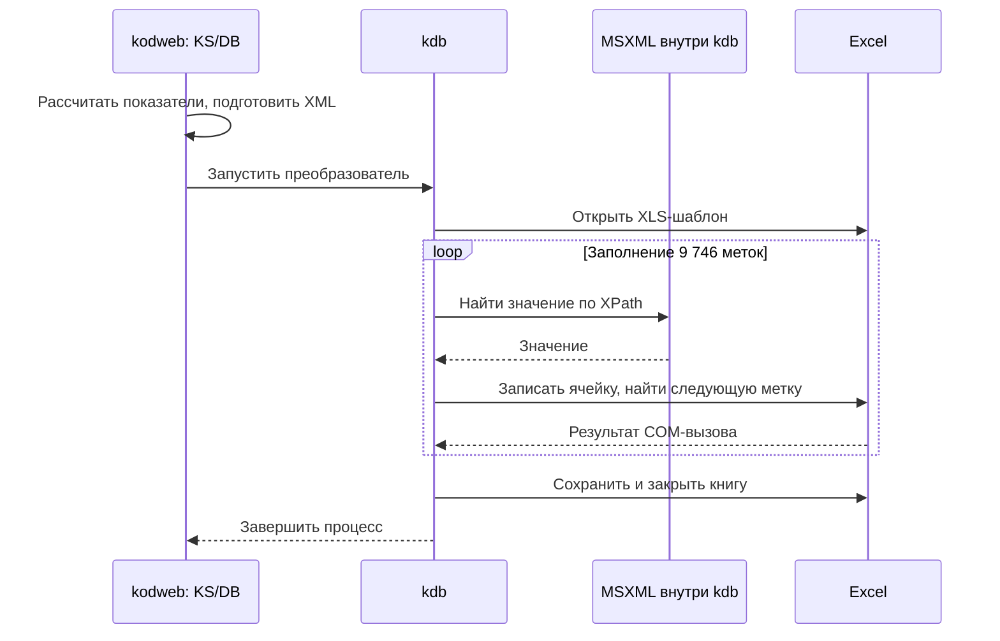

# Профиль удаления и 1АС: kodweb и codex-AIs 0.18

18–19 ноября 2026 года. Измерения на одной независимой копии полного комплекта. В основной серии код серверов и настройки не менялись; отдельный опыт меняет только режим расчёта Excel в частной копии конвертера. [Числа и условия в JSON](profiling-0.18.json).

## Основные результаты

- Два удаления: kodweb — 342,420 с по очереди и 763,146 с одновременно; Rust — 28,503 и 17,003 с.
- Два 1АС по очереди: kodweb — 1 474,237 с, Rust — 87,773 с. Парный Rust — 61,175 с; два целых XLS от парного kodweb получить не удалось из-за сброса HTTP-соединения.
- Одинаковый XML → XLS в штатном kdb/Excel: автоматический пересчёт — 189,212 с; ручной режим при заполнении с одним явным полным пересчётом — 121,889 с. Совпали значения, формулы и сохранённые результаты формул.

Синхронный пул потоков сам по себе не объясняет результаты. В kodweb два запроса получают CPU одновременно. В Rust KS и DB также исполняются синхронно, в отдельных системных потоках; Tokio обслуживает сеть и очереди. Существенны объём работы, организация кэша, синхронизация и способ формирования XLS.

## Условия проверки

- Windows Server 2025 x64; Windows видит Xeon Silver 4516Y+, 6 ядер / 12 логических процессоров, 32 ГиБ RAM. Это описание гостевой системы, не гарантия топологии физического хоста.
- `kodweb.exe` 5.3.2.120, x86; опубликованный `codex-AIs.exe` 0.18, x64. Excel x86 16.0.20527.20196, штатный преобразователь с MSXML 4. Хеши EXE сохранены в JSON. kodweb64 в этой серии не использовался.
- Полная независимая копия из 753 753 файлов. Свежий снимок выбранных DB/config/KOD-файлов — 190,64 ГиБ, 13 637 файлов. Серверы работают строго по очереди. Перед каждой серией удаления восстановлен тот же снимок; старые пользовательские изменения сохранены.
- Два независимых реальных документа 2026 года из архивного тома: каскады 1 и 5 объектов. Штатное «Удалить все объекты», отметка удаления включена; без дополнительной информации и полной проверки ссылок. Время включает KOD и аудит. До таймера открываются главная и атрибуты, но не предварительный список удаления.
- 1АС: 01.01–31.01.2025, без фильтра коллегии, судьи и состава. Период подтверждён XML самого kodweb. Год 2024 на титуле уже находится в исходном XLS-шаблоне и не определяет отбор. Это не повтор годового теста за 2025 год.
- Для каждого сервера: диагностический одиночный 1АС, два отчёта по очереди, затем два одновременно. У kodweb парная серия повторена из-за обрыва HTTP; в обоих случаях получен только один целый XLS. Эти пары не считаются успешно выполненными. Все целиком полученные файлы проверяются. В Rust одиночные тяжёлые запросы используют первого свободного исполнителя: первый парный запуск впервые нагружает и второго. Поэтому «прогрет процесс» не означает одинаковое состояние всех локальных кэшей.
- Повторная пара kodweb и отчёты Rust запрошены с `Connection: close`; добавлено сохранение частичного тела ответа при ошибке. URI и параметры формы прежние. Повтор снова дал сброс соединения, поэтому объяснять проблему одним keep-alive нельзя. Дополнительный прогрев kodweb при повторе тоже учитывается как различие условий.
- Кэш ОС не очищался. По одному контрольному запуску каждого сочетания; это не медианы и не оценка предельной нагрузки.

## Время без профилировщика

| Удаление двух документов | kodweb, с | Rust 0.18, с |
|---|---:|---:|
| По очереди | 342,420 | 28,503 |
| Одновременно | 763,146 | 17,003 |

Время отдельных ответов по очереди: kodweb — 117,831 и 224,455 с; Rust — 27,177 и 1,259 с. Одновременно: kodweb — 649,568 и 763,078 с; Rust — 16,087 и 16,963 с. Второе последовательное удаление использует состояние кэша после первого: это не две независимые оценки «типичного документа».

| Счётчики серии удаления | kodweb по очереди | kodweb одновременно | Rust по очереди | Rust одновременно |
|---|---:|---:|---:|---:|
| CPU процесса, с | 341,297 | 1 011,703 | 18,188 | 18,422 |
| Логические чтения, операций | 3 596 826 | 7 364 409 | 608 325 | 628 196 |
| Логически прочитано, ГиБ | 13,707 | 28,062 | 29,073 | 29,152 |
| Пик private bytes процесса, МиБ | 294,0 | 480,7 | 289,6 | 336,7 |

| 1АС за январь 2025 | kodweb, с | Rust 0.18, с |
|---|---:|---:|
| Два по очереди | 1 474,237 | 87,773 |
| Два одновременно | Не подтверждено: 1/2 целых ответов в обеих попытках | 61,175 |

Отдельные последовательные ответы: kodweb — 723,527 и 750,580 с; Rust — 44,266 и 43,449 с. Одновременные ответы Rust — 61,139 и 49,186 с.

Повторная пара kodweb завершилась примерно через 968,714 с: один XLS получен полностью, другой ответ оборвался. Процесс сервера оставался жив, оба конвертера завершились. Это наблюдение о получении результата тестовым HTTP-клиентом, **не доказательство, что второй отчёт не был рассчитан**. Успешную пропускную способность пары по этой попытке оценивать нельзя.

Контрольные серии записывают счётчики процесса и потоков примерно раз в секунду. ETW, сборка, разбор трасс и восстановление базы во время этих замеров не выполнялись. В первом последовательном отчёте kodweb однократно сохранены 4,9 МБ входов конвертера для отдельного опыта; это заняло 0,191 с и входит в измерение. CPU дочерних процессов оценивается по последним доступным выборкам, поэтому это нижняя оценка, а не точный учёт всего CPU машины.

## Удаление: дополнительная работа и короткие ожидания

На тех же двух объектах kodweb потребовал **342,420 с по очереди и 763,146 с одновременно**. Суммарный CPU процесса вырос с 341,297 до 1 011,703 с, логические чтения — с 3 596 826 до 7 364 409. Ухудшение есть в контрольном запуске без ETW; оно не объясняется только накладными расходами профилировщика.

Отдельная трасса показывает два активных рабочих потока. В одном окне длительностью 21,33 с они находились на CPU 15,69 и 14,99 с; завершённые интервалы блокировки составили 3,27 и 3,67 с. Основной стек ожидания проходит через `RtlEnterCriticalSection`, `RtlpEnterCriticalSectionContended`, `RtlpWaitOnCriticalSection` и `NtWaitForAlertByThreadId` из обёртки kodweb. После завершения первого запроса конкуренция заметно уменьшается.

Это подтверждает конкуренцию за критические секции. **Какой именно объект они защищают, не установлено.** Из-за отсутствия PDB и усечённых x86-стеков нельзя объявлять найденную обёртку единственным глобальным mutex всей базы. Отсутствие длинной цепочки в коротких снимках Wait Chain Traversal не опровергает частые короткие ожидания из ETW.

В середине трассы зарегистрировано 147 701 логическое чтение по 4 КиБ из одного архивного тома. В этом окне для выбранного PID нет событий физического DiskIO; в других окнах они есть. Это не счётчик всего дискового трафика системы. Наряду с ожиданиями профиль содержит выделение/освобождение памяти, CRT-копирование и обращения к механизму синхронизации. Среди горячих участков есть неблокирующий опрос сокета через `select` с нулевым тайм-аутом; его наличие не означает ожидание медленной сети.

Для этих 147 701 чтений в одном окне найдено 142 222 разных сочетания «смещение + размер»: 5 479 повторов, максимум два обращения к одному сочетанию. То есть повторные смещения есть, но большинство чтений внутри окна уникальны. Это не доказательство многократного перечитывания одной страницы или конкретной политики вытеснения кэша. Удвоение общего числа чтений в парном контрольном запуске — отдельное наблюдение за всей серией.

Рост логических чтений показывает дополнительные обращения. Он сам по себе не раскрывает устройство кэшей kodweb: разделённые состояния, вытеснение и повторные вычисления здесь ещё не разделены отдельным экспериментом.

## 1АС: расчёт и преобразование — разные стадии

В окне расчёта одиночного 1АС рабочий поток получил 21,207 с CPU за 21,225 с, а завершённые ожидания составили около 1,85 мс. В этой стадии запрос ограничен вычислительной работой. Среди листовых CPU-сэмплов этого окна: линейный поиск строки в списке — 9,5%, `memmove` — 4,8%, `memset` — 4,2%, обработка битовых наборов — 4,2%, атомарные увеличение/уменьшение счётчиков — 6,8%. Это доли выбранного диагностического окна, не всего отчёта.

Назначение первых и битовых циклов проверено по машинному коду той же сборки: поиск сравнивает строку с последовательными NUL-строками; подсчёт битов использует таблицу для четырёхбитных частей. Контекст конкретных SQL/KS-операций выше этих функций восстановлен не полностью. Выборочные стеки не дают права назвать одну из них причиной всего времени отчёта.

После расчёта kodweb запускает `kdb.exe`, а тот создаёт Excel через COM. В шаблоне 13 листов, **9 746 заполняемых XPath-меток и 17 250 формул**. Конвертер ищет метки и присваивает значения отдельным ячейкам. Автоматический пересчёт включён в шаблоне; штатный скрипт его не отключает.

В окне конвертации основной поток Excel находился на CPU около 18,46 с. Поток COM-обращений kdb около 16,98 с ждал в цепочке `CSyncClientCall::SendReceive` → `ClassicSTAThreadWaitForCall` → `CCliModalLoop::BlockFn`. MSXML тоже виден в профиле, но его CPU существенно меньше. Имена внутренних горячих функций Excel не разрешены; один стек не отделяет пересчёт от поиска ячеек и остальных действий объектной модели.

Диагностический одиночный отчёт занял 823,613 с: процесс kdb появился примерно на 253-й секунде и завершился около 823-й. Это иллюстрация стадий, **не время для таблицы производительности**: запуск включал ETW, а после записи окон начался их разбор. CPU kodweb включает дополнительную активность другого рабочего потока; всё время процесса нельзя приписывать одному запросу.

### Опыт с одним явным пересчётом

Сохранены XML и шаблон первого последовательного отчёта. После остановки серверов один и тот же `kdb.exe` дважды получил эти входы: сначала неизменённый конвертер, затем его отдельную экспериментальную копию. Каждый запуск использовал новый Excel и свежую побайтно одинаковую копию XLS-шаблона. Его поток Workbook также совпадает с независимым сохранением шаблона исходного kodweb. Сам Excel меняет служебное время корневой записи CFB при открытии, поэтому повторно использовать уже открывавшийся файл для проверки полного хеша нельзя.

Изменены только три действия: после открытия книги — `Calculation = Manual`, после заполнения — один `CalculateFull()`, затем восстановление `Automatic` перед сохранением и закрытием. Поиск ячеек, отдельные COM-присваивания, XPath/MSXML и XML остались прежними. «Один пересчёт» здесь означает один **явный полный** вызов в конце: открытие книги и переключение режима тоже могут инициировать работу Excel.

| Конвертация без KS/DB | Время, с |
|---|---:|
| Штатный автоматический режим | 189,212 |
| Ручной режим при заполнении + `CalculateFull` | 121,889 |

Разница — 1,55 раза на этом шаблоне. Совпали 37 947 позиций констант, 17 250 формул, 13 листов и все сохранённые результаты формул между этими двумя запусками. Предварительный опыт дал 120,089 с; относительно исходного отчёта там изменился только результат `TODAY()` после полуночи. Код функции проверен по [таблице Ftab](https://learn.microsoft.com/en-us/openspecs/office_file_formats/ms-xls/00b5dd7d-51ca-4938-b7b7-483fe0e5933b).

Это подтверждает существенную стоимость автоматического пересчёта при заполнении. Оставшееся время включает Excel, COM, поиск ячеек, MSXML и сохранение. Внутри исходных последовательных HTTP-запросов процесс kdb наблюдался около 539 и 561 с; отдельный автоматический запуск оказался быстрее. Контекст этой дополнительной разницы не изолирован, поэтому нельзя вычитать 121,889 с из времени исходной конвертации и весь остаток объявлять ценой пересчёта. Опыт не даёт отдельной доли остальных расходов; это один запуск на режим, не серия медиан. Проверка выполнена на отдельной копии конвертера.

### Что происходит при двух расчётах 1АС

Дополнительно записан ограниченный профиль двух запросов: клиентские соединения намеренно закрыты через 100 с, до завершения расчёта. Это диагностический запуск без готовых отчётов; он не входит в таблицу скорости.

В окне 21,055 с два рабочих потока получили 20,769 и 20,541 с CPU. Завершённые блокировки заняли 0,178 и 0,361 с. В отличие от удаления, длительное ожидание критических секций здесь не доминирует. В CPU-сэмплах остаются поиск строк, копирование памяти, битовые операции, атомарные счётчики и вход/выход из критических секций. Относительные доли этих участков близки к одиночному окну; профиль не выделил одну функцию, объясняющую весь рост CPU при двух запросах.

Во время полной парной попытки работали два отдельных процесса Excel. Следовательно, единой глобальной очереди «только один Excel на сервер» в этом опыте не было. Есть последовательные COM-вызовы внутри каждого конвертера. Точные причины дополнительного CPU и разницы между конвертацией внутри HTTP-запроса и отдельным kdb пока не изолированы; объяснение через один общий mutex или исключительно разрядность EXE было бы сильнее полученных данных.

Microsoft рекомендует уменьшать число отдельных обращений к ячейкам, записывать диапазоны блоками и управлять пересчётом во время массовых изменений. Это направления для ускорения самого преобразователя, независимо от языка сервера. [Рекомендации по Excel](https://learn.microsoft.com/en-us/office/vba/excel/concepts/excel-performance/excel-tips-for-optimizing-performance-obstructions), [описание CalcMode в XLS](https://learn.microsoft.com/en-us/openspecs/office_file_formats/ms-xls/792088e4-c3b4-4020-8ff8-37ed95e82a34).

## Что меняет Rust

В контрольных удалениях CPU процесса почти не меняется при переходе от очереди к паре: **18,188 → 18,422 с**. Число логических чтений растёт с 608 325 до 628 196, а не удваивается. При этом Rust читает около 29,15 ГиБ против 28,06 ГиБ у парного kodweb: выигрыш здесь не означает меньше прочитанных байтов. Обращений существенно меньше, и меньше работа CPU.

В отдельной 18-секундной трассе Rust основной исполнитель получил 16,966 с CPU, второй — 2,861 с. У второго 13,417 с ожидания находятся точно в `Condvar::wait_timeout` → `SharedQueries::build`: он ждёт построения общего результата. Это подтверждённый стек с PDB Rust. Две полностью независимые копии вычисления здесь не выполняются.

В работе построителя видны чтение файлов и копирование страниц ОС, выделение памяти, чтение скалярных полей и подготовка снимка для записи. Это оставшиеся направления оптимизации, а не доказательство, что все расходы уже устранены. В оптимизированной сборке некоторые функции объединены компоновщиком; неоднозначные одиночные имена символов не используются как объяснение сценария.

Для 1АС остаются чтения, распаковка полей, копирование строк и схем. Два отчёта Rust одновременно занимают 61,175 с против 87,773 с по очереди, но CPU процесса растёт с 87,688 до 109,891 с, а пик private bytes — примерно с 525 до 862 МиБ. Это полезное, но не линейное ускорение; второму тяжёлому исполнителю в паре впервые понадобились собственные локальные данные.

В 0.18 исполнители используют общий неизменяемый кэш диапазонов и обратных ссылок: один строит недостающий результат, остальные ожидают его и используют готовые массивы. Запись рабочего тома не выбрасывает кэш неизменённых архивов. Это сокращает повторную работу; само ожидание построителя ещё не означает неэффективную блокировку. [Реализация кэша](../src/db/shared_query.rs), [отдельное сравнение версий 0.17.1 и 0.18](SHARED_CACHE_0.18.md).

Для XLS Rust строит таблицу значений XML и меняет BIFF8-записи штатного шаблона непосредственно в памяти. Отдельных процессов kdb/Excel и тысяч межпроцессных присваиваний нет. **Сервер Rust не пересчитывает формулы Excel:** они сохраняются с признаками необходимости пересчёта клиентом. Основная сверка исходных файлов проверяет значения, формулы и листы; кэш формул дополнительно проверен после пересчёта одной книги в Excel. [Код конвертации](../src/ks/xml_report.rs), [запись XLS](../src/ks/xls_report.rs).

Публикация DB4 по-прежнему согласована последовательно, с прежним журналом восстановления. Параллельны подготовка и вычисления; единой транзакции всего каскада нет. В этой задаче код writer и формат журнала не менялись, отдельное испытание аварийного отключения не повторялось. [Протокол восстановления](DB40_WRITES.md), [проверки выпуска 0.18](VALIDATION_0.18.md).

## Проверка результата и границы выводов

- Все контрольные удаления завершились: ожидаемые шесть KOD на серию, удалённые объекты отсутствуют, родительское дело сохранено.
- Выполнены 30 семантических сравнений KOD и 10 сравнений рабочих томов — 5 115 полных записей суммарно. Совпали OID, отметки и поля. Аудит с разными временами и порядком действий не требовался побайтно одинаковым; его файлы тоже восстановлены из снимка.
- Проверены 14 полных XLS, включая пять Rust, три результата отдельного конвертера и одну книгу Rust после контрольного пересчёта. Совпали значения 37 947 позиций констант, 17 250 формул и порядок 13 листов. Частичный HTTP-ответ kodweb исключён.
- В каждой исходной книге Rust 62 сохранённых результата формул отличаются от рассчитанного Excel-эталона. Сами формулы совпадают. Одну готовую книгу Rust дополнительно пересчитали в отдельном Excel: **совпали и все сохранённые результаты формул** с автоматическим контрольным конвертером. Это проверка клиентского пересчёта, не часть времени формирования на сервере Rust.
- Исходный `C:\kodeks` не использовался для записи. Тестовая копия восстановлена, шесть контрольных хешей исходного комплекта перепроверены. Порядок переключения серверов соблюдён; v2rayN не изменялся.

Профили записаны Windows Performance Recorder: CPU-сэмплы, переключения/пробуждения потоков, логическое FileIO и физическое DiskIO. Разбор — Microsoft TraceEvent 3.2.8, системные символы Microsoft и PDB проверенной Rust-сборки. События анализируются по PID сервера и конвертеров. [Описание WPR](https://learn.microsoft.com/en-us/windows-hardware/test/wpt/recording-for-basic-system-diagnosis), [TraceEvent](https://github.com/microsoft/perfview/blob/main/documentation/TraceEvent/TraceEventProgrammersGuide.md).

Сбор стеков переключения потоков заметно влияет на нагрузку: в трассах видны `EtwpTraceStackWalk` и разворачивание стека. Поэтому таблицы скорости взяты из запусков без ETW, а трассы используются для локализации работы и ожиданий. Незавершённые ожидания на краях окон исключены. Профиль не доказывает единственную причину всей разницы, не распространяется автоматически на другие базы, HDD, версии Office и большее число запросов.

Сырые ETL, данные дел, KOD, XLS/XML, штатные KS и дизассемблированный код в Git не включены. Публикуются обезличенные агрегаты и выводы. [Устройство проекта и направления развития](ARCHITECTURE_AND_PERFORMANCE.md).
