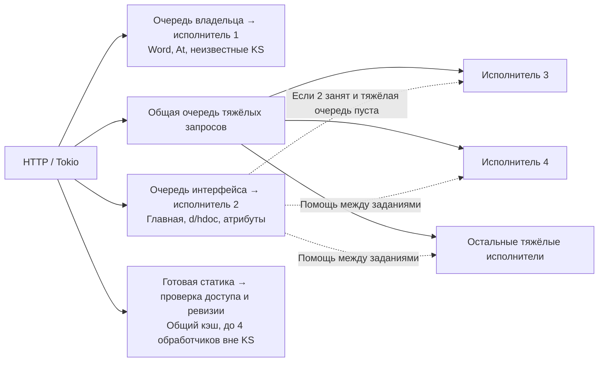

# Очереди и исполнители в 0.23

В 0.23 удаления, поиск и отчёты ждут в общей очереди, из которой освободившийся исполнитель берёт следующий запрос. В тяжёлую группу входят все отчёты и справки меню судебной статистики контрольного комплекта — 31 пункт. Само меню обслуживает интерфейс; две редактируемые статистические карточки остаются у владельца. Свободные тяжёлые исполнители помогают занятому интерфейсу, а готовые статические ресурсы выдаются вне KS. Формат DB4 и владение состоянием фоновых очередей и Word сохранены. [Проверка маршрутов и помощи интерфейсу](INTERFACE_0.23.md).

## Что мешало в 0.22

Диспетчер выбирал исполнителя при поступлении запроса по числу его активных и ожидающих заданий. Продолжительность заданий заранее неизвестна. Поэтому два исполнителя могли получить такие очереди:

| Исполнитель | Выполняется | Ожидает |
|---|---|---|
| 3 | Годовой отчёт | Короткий отчёт B |
| 4 | Короткий отчёт A | Короткий отчёт C |

После завершения A и C исполнитель 4 простаивал, а B продолжал ждать годовой отчёт. Увеличение лимита ожидания не решало эту проблему.

В 0.23 ожидающие A, B и C находятся в общей FIFO-очереди. Состояние Runtime и файловые читатели остаются у каждого исполнителя; между потоками передаются только ещё не начатые запросы. Блокировка очереди снимается до авторизации, выполнения KS и чтения DB4. Уже выполняющийся запрос не переносится между потоками и не вытесняется.

Схема относится к настройке с четырьмя или более исполнителями. При одном все запросы последовательны. При двух интерфейс и Word используют владельца, а тяжёлая работа имеет один отдельный исполнитель. При трёх интерфейс уже выделен, но тяжёлый исполнитель всё ещё один.

## Как выбирать настройки

| Параметр | По умолчанию | Что ограничивает |
|---|---:|---|
| `workers` | `auto` | 3, 4 или 6 системных потоков по доступным CPU; ручное число 1–32 имеет приоритет |
| `queue` | 16 | Ожидающие запросы, без уже исполняющихся; дополнительно есть по одному резервному месту для владельца и интерфейса |
| `connections` | 64 | Открытые HTTP-соединения, включая простой keep-alive |
| `keep_alive_seconds` | 60 | Ожидание следующего запроса на постоянном соединении, в том числе Word |

Оптимального набора для всех судов нет. Он зависит от числа одновременно работающих пользователей, длительности отчётов, доступной памяти, диска и числа ядер. Для четырёх исполнителей значение «2 из 4 занято» может означать, что все тяжёлые исполнители уже заняты. В мониторе 0.23 занятость этой группы показана отдельно.

`queue` не задаёт число параллельных вычислений. Большая очередь принимает больше работы в ожидание, но увеличивает задержку последних клиентов. `connections` тоже не задаёт число вычислительных потоков: сеть обслуживается Tokio. При заполнении этих лимитов сервер отвечает HTTP 503.

Увеличивать `workers` имеет смысл, если тяжёлые запросы регулярно ждут, а процессор и память позволяют выполнять больше работы. При `workers >= 3` одновременно могут работать `workers - 2` тяжёлых запроса. Это не ускоряет отдельный отчёт за счёт автоматического разделения по ядрам. Запись DB4 остаётся согласованной; увеличение числа исполнителей не отменяет её блокировки и журнал.

## Автоматический выбор при запуске

В файле настроек допустимы `workers=auto` и `workers=1` … `workers=32`. Без файла или при отсутствии этого поля используется `auto`. Существующее числовое значение, в том числе `workers=4` из старой версии, остаётся ручным. Автоматический выбор не заменяет его даже при изменении числа доступных CPU.

| Ядер для расчёта | Исполнителей | Для тяжёлых запросов |
|---|---:|---:|
| 1–2 | 3 | 1 |
| 3–5 | 4 | 2 |
| 6 и более | 6 | 4 |

Результат определяется один раз при запуске. Сохранение настроек не меняет работающий пул; форма показывает, что нужен перезапуск. При сохранении других параметров значение `auto` сохраняется без преобразования в число. В `/admin?status` и журнале запуска указаны режим, выбранное число и основание выбора.

В Windows учитываются пересечения масок процесса и стартового потока с топологией ядер в его основной группе процессоров. Дополнительно учитывается доступный жёсткий CPU-лимит непосредственного Job Object. В Linux используются доступный параллелизм Rust, список разрешённых CPU текущего потока и группы SMT из sysfs. В FreeBSD используются cpuset и консервативная оценка по `kern.smp.cores` / `kern.smp.threads_per_core`.

Если топология недоступна, для оценки принимаются два логических CPU на ядро; это явно отмечается в мониторе. Если сведений о CPU нет совсем, выбираются три исполнителя. Оценка ядер ограничена доступным параллелизмом, чтобы системная топология не увеличила пул сверх обнаруженного ограничения CPU.

Это начальная эвристика по CPU. Свободная память, текущая загрузка, различия производительности P/E-ядер, ограничения родительских Job Object и скрытые квоты гипервизора не определяют число исполнителей. Пул не перестраивается во время работы. На машинах с небольшой памятью или необычными ограничениями можно задать ручное число. API доступного параллелизма само возвращает оценку с платформенными ограничениями: [Rust](https://doc.rust-lang.org/std/thread/fn.available_parallelism.html). Сведения о топологии: [Windows](https://learn.microsoft.com/en-us/windows/win32/api/sysinfoapi/nf-sysinfoapi-getlogicalprocessorinformationex), [Linux](https://www.kernel.org/doc/html/v5.7/admin-guide/cputopology.html), [FreeBSD](https://man.freebsd.org/cgi/man.cgi?manpath=FreeBSD+13.1-RELEASE+and+Ports&query=SMP&sektion=4).

Собственный файл настроек Rust не меняет совместимость томов с kodweb. Для запуска старой версии codex-AIs 0.22 в этом файле требуется числовое `workers`: её парсер ещё не принимает `auto`.

## Проверка

Измерения выполнены на полной независимой копии контрольного комплекта, Windows x64, 6 ядер / 12 логических процессоров Xeon Silver 4516Y+, 32 ГБ памяти. Используется отчёт 1АС о работе суда, все коллегии, составы и судьи. Время HTTP-запроса включает ожидание, расчёт и получение готового XLS. Процессорное время — сумма времени потоков серверного процесса, включая сопутствующие запросы интерфейса.

Первый сценарий: один отчёт за весь 2025 год и три отчёта за 1 января 2025 года. Перед измерением тяжёлые исполнители формируют отчёт за январь. Во время основной серии проверяются главная, каркас документа `d` и `/99?testconnection`; это не замер полного открытия Word или всех фреймов документа в браузере. Монитор опрашивается примерно раз в секунду. Кэш файлов Windows не очищается, поэтому разницу длительности самого годового расчёта нельзя целиком приписывать диспетчеру.

### Смешанная длительность, четыре исполнителя

| Запрос / показатель | 0.22 | 0.23 |
|---|---:|---:|
| Короткий отчёт A | 40,35 с | 39,54 с |
| Короткий отчёт B | 416,03 с | 77,61 с |
| Короткий отчёт C | 80,30 с | 115,39 с |
| Годовой отчёт | 377,04 с | 317,63 с |
| Завершение всей группы | 416,79 с | 317,63 с |
| Процессорное время группы | 508,33 с | 460,50 с |
| Максимум ответа проверяемых интерфейсных запросов | 89 мс | 92 мс |
| Пик частной памяти процесса | 1 001 МиБ | 1 017 МиБ |

В 0.22 монитор 249 раз зафиксировал ожидающий отчёт при свободном тяжёлом исполнителе. В 0.23 таких наблюдений не было. Последний из коротких отчётов получен за 115,39 с вместо 416,03 с — в 3,6 раза раньше в данном сценарии. Отчёт C теперь ждёт своей очереди после B, поэтому его индивидуальное время увеличилось. Это последовательный порядок выдачи ожидающих запросов, а не отдельный приоритет для коротких отчётов.

Изменение очереди не ускоряет само вычисление годового отчёта. В этой паре запусков оно также стало быстрее, но замеры сделаны последовательно без очистки системного кэша. Разницу 377 → 318 с нельзя считать отдельно доказанным эффектом нового диспетчера. Суммарные времена приведены как наблюдение; главный подтверждённый результат — устранение ожидания при простаивающем подходящем исполнителе.

### Четыре месячных отчёта

Второй сценарий сравнивает четыре одинаковых отчёта за январь 2025 года при разных размерах пула после прогрева.

| Показатель | `workers=4` | `workers=6` |
|---|---:|---:|
| Тяжёлых исполнителей | 2 | 4 |
| Все четыре XLS получены | 123,56 с | 76,56 с |
| Первый готовый XLS | 55,72 с | 72,75 с |
| Процессорное время | 243,31 с | 288,42 с |
| Пик частной памяти процесса | 1 081 МиБ | 1 683 МиБ |
| Медиана ответа проверяемых интерфейсных запросов | 57 мс | 64 мс |
| 95-й процентиль ответа | 85 мс | 90 мс |
| Максимум ответа | 102 мс | 118 мс |

Серия при шести исполнителях закончилась на 38% раньше, пропускная способность в этом опыте выросла в 1,61 раза. Процессорного времени потребовалось на 19% больше, памяти — на 56% больше. Первый отчёт появился позже: четыре одновременных расчёта конкурируют за ресурсы сильнее, чем два. Превышение процессорного времени над временем выполнения нормально: складывается работа нескольких потоков.

Для этой машины с частыми одновременными отчётами `workers=6` — полезный проверенный вариант; новый режим `auto` также выбирает здесь шесть исполнителей. Измерения выполнены с ручными значениями 4 и 6, по одному измеряемому запуску каждого; это не поиск универсального максимума для других процессоров, дисков и комплектов данных. Более крупные пулы нужно оценивать отдельно по времени всей серии, задержке интерфейса и памяти.

`queue=16` и `connections=64` в серии не ограничивали производительность: наблюдалось максимум пять одновременных соединений. Нет оснований увеличивать эти два значения ради ускорения данного расчёта. При большом числе пользователей стоит отдельно учитывать их простаивающие keep-alive-соединения. Изменение настроек через `/admin?advanced` применяется после перезапуска.

### Совместимость и границы проверки

Книги сравнены независимым читателем BIFF8: имена листов, значения ячеек и формулы. Для всех 18 книг новой версии, включая прогрев и оба размера пула, совпали все 55 267 ячеек каждой книги с результатами 0.22.

При двух активных предварительных списках удаления и 16 ожидающих запросах главная ответила за 58 мс, `d` — 229 мс, `hdoc` — 58 мс, проверка Word — 32 мс. После отключения клиентов остановка активных обходов подтверждена за 406 мс, сохранённых записей DB4 — 0. Проверены последовательные запросы Word на одном TCP-соединении, смена авторизации между запросами, HTTP/1.0, HTTP/1.1 и pipelining.

При заполнении всех HTTP-слотов обнаружено, что немедленное закрытие сокета с непрочитанным запросом иногда превращало ответ 503 в разрыв TCP на Windows. В 0.23 сервер сначала завершает передачу ответа, затем дочитывает вход до закрытия клиента. На весь отказ по-прежнему отведено не более 100 мс; заполненное соединение не получает KS-исполнитель.

На финальной сборке удерживались 64 постоянных соединения: все десять дополнительных подключений получили 503 без разрыва при чтении ответа. После освобождения одного места новое подключение получило 200. При 60 простаивающих соединениях главная ответила за 42 мс. Это проверка границы и обработки перегрузки, а не измерение производительности 60 активных пользователей.

### Проверка режима auto

На той же полной копии проверены реальные перезапуски с разными настройками и ограничениями тестового процесса:

| Условие запуска | Выбрано |
|---|---:|
| Файла настроек нет, доступны 6 ядер / 12 логических CPU | auto → 6 |
| Сохранено `auto`, изменён только `queue`, затем перезапуск | auto → 6; новое значение очереди применено |
| Сохранено `workers=4`, доступен один логический CPU | вручную → 4 |
| Сохранено `auto`, доступен один логический CPU | auto → 3 |
| Сохранено `auto`, доступны три ядра | auto → 4 |
| Возвращена полная конфигурация CPU | auto → 6 |

Сохранение через `/admin?advanced` оставляло работающий пул прежним; новое число применялось только после перезапуска. В форме и мониторе проверены режим, выбранное число и объяснение. Изменение другого параметра сохраняло именно `workers=auto`, резервная копия содержала прежние настройки.

На автоматически выбранном пуле одновременно сформированы четыре отчёта 1АС за январь 2025 года. Монитор подтвердил работу исполнителей 3, 4, 5 и 6; все четыре XLS побайтно совпали с контрольными результатами 0.22. Главная, `hdoc` и `/99?testconnection` отвечали во время расчёта. Это функциональная проверка запуска без предварительного прогрева отчётами, а не дополнительная серия измерения ускорения.

При проверке очередей и режима auto прошли 427 обычных тестов; 79 дополнительных проверок пропущены по их штатным условиям. Среди новых проверок — общая очередь при занятом исполнителе, изоляция групп для всех допустимых размеров пула, доставка 503 при непрочитанном HTTP-запросе, разбор топологии, ограничение CPU, сохранение `auto` и приоритет ручного значения. Изменения проверены на Windows x64; отдельный прогон новой версии на Linux и FreeBSD ещё не выполнен.

Следующая проверка 0.23 посвящена [размеру локального кэша страниц](SCALAR_CACHE_0.23.md). Во всех её вариантах используется одинаковый пул из шести исполнителей, поэтому изменение размера пула не смешивается с эффектом кэширования.
